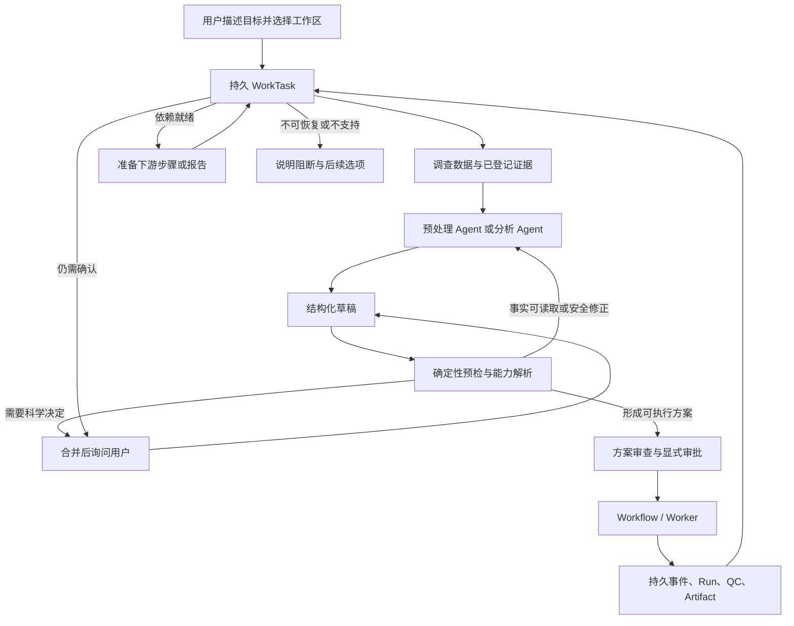

# Agent 通用自动化运行架构方案

- 状态：Implementing
- 文档类型：Architecture
- 维护者：system_architect
- 创建日期：2026-10-12
- 更新日期：2026-10-17
- 关联：[系统设计](system-design.md)、[Skill 层架构](fmri-skill-layer.md)、[计划 0014：静息态 fMRI Agent 通用自动化体验](../plans/0014-general-agent-automation.md)、[ADR 0041：分析提案续接](../adr/0041-proposal-only-analysis-continuation-outbox.md)、[ADR 0042：统计结果解释续接](../adr/0042-statistical-result-interpretation-outbox.md)、[ADR 0044：步骤 readiness 与收口边界](../adr/0044-worktask-step-readiness-handlers.md)、[ADR 0045：有界线性步骤调度（提议）](../adr/0045-bounded-linear-worktask-step-scheduling.md)、[MVP 验证与已知限制](../development/mvp-verification.md)

本文定义 Agent 如何围绕静息态 fMRI 的预处理和统计分析目标，持续完成调查、方案准备、校验、等待、恢复和结果交付。它描述应保持的架构边界，不表示计划 0014 中的所有能力已经实现；具体实现状态以计划 0014 和验证记录为准。

## 架构评估结论

当前项目可以沿现有架构继续开发，不需要推倒重做 Agent、Skill 或 Workflow，也不需要增加一个拥有更大权限的协调 Agent。已有的模块化单体、预处理/分析双 Agent、结构化 Skill、不可变方案与审批、受控 Worker、Artifact lineage 和统计结果合同，已经构成可信的科研执行底座。

用户感受到的“一步一步来、稍有问题就停住”，主要来自**目标级编排还没有闭合**：一次请求内的模型反馈环与跨请求、跨运行的任务恢复是两类不同问题。前者需要把可读取事实、草稿修订、Skill/统计预检和停止原因接成统一的有界回路；后者需要让持久任务在 Run、QC、Artifact 或用户决定变化后重新核验依赖，再准备下一个步骤。单纯增加提示词、模型迭代轮数或 Agent 数量无法代替这两项应用层能力。

现有持久任务和事件重核已经打下基础，部分预处理到分析的草稿续接、统计结果解释续接也已接入；但这不等于任意复合目标都能自动完成。多目标、多意图的步骤依赖、完整的失败恢复和目标完成判定仍需按计划 0014 的验收范围逐步补齐。当前建议是保留科研规则与执行授权边界，优先补齐反馈预检和持久推进闭环，再按能力合同扩展支持范围。

## 设计结论

复合分析目标的前台选择由现有角色任务 JSON 中的 `analysis_intent_task_id` 表达，不复制目标生命周期。读取草稿、交接、历史和来源上下文时按该身份过滤；不同目标的后台续接只保存自身结果，不改变已选前台。未冻结草稿恢复及提案消息身份门禁由 [ADR 0046](../adr/0046-composite-goal-foreground-selection.md) 定义，已有 Plan/Run 恢复另行扩展。

通用自动化不依赖一个无限运行或拥有完整权限的 Agent。系统由两个有界循环配合：一次请求内的反馈循环负责理解、读取证据、形成提案并修正可修正的问题；持久任务循环负责跨消息与异步运行保存目标、等待权威状态变化，并决定下一项允许的步骤。前者结束后释放模型资源，后者在事件或用户输入到达时恢复。

Agent 负责理解目标、选择已登记的能力、解释证据和提出结构化草稿。确定性服务负责输入事实、科研规则、状态转换、并发控制、授权、执行和产物登记。Agent 可以生成建议，不能凭空扩大系统能力，也不能把工程恢复变成科学方法变更。

### 推荐方案摘要

本项目应在现有本地优先模块化单体中增加目标级编排能力，不另建一个自由执行的通用 Agent 框架，也不以增加单轮模型调用次数代替跨运行状态管理。落地时遵循以下决策：

1. **把目标身份与阶段执行分开。** 一个独立工作阶段由 `WorkTask` 保存目标、当前步骤、等待原因和权威对象引用；一个显式复合目标由 `CompositeGoal` 保存稳定身份并关联多个阶段 WorkTask 和 outbox。`CompositeGoal` 只做身份关联和最新进度投影，不复制 Plan、Approval、Run、QC 或 Artifact 的生命周期状态。
2. **让模型规划，让确定性服务推进。** 模型可调查证据、提出或修订未批准草稿、解释结果；能力校验、状态迁移、授权、执行和产物完成判定由应用/领域服务完成。
3. **把“继续”实现为持久循环。** Worker 事件只唤醒任务；协调器重新读取当前 Run、QC、输入修订和 Artifact，幂等判断依赖是否满足。重启和漏事件由周期扫描恢复，不保留后台模型会话。
4. **用能力合同限制自动化范围。** 每个预处理指标或统计方法都声明输入证据、前置条件、科学参数、执行单元、输出和失败语义。先自动编排已经登记并验证的能力组合，不允许 Agent 临时拼接任意 MATLAB/DPABI 命令。
5. **只自动修工程问题，不自动替研究者作方法学选择。** 可读取事实自动补查；不改变科学语义的格式问题可在草稿中修正；样本纳排、检验、协变量和校正等决定集中询问用户；未支持能力与证据冲突要明确阻断。
6. **按目标合同收口。** Run 成功本身不代表科研目标完成。每个步骤必须验证冻结输入、QC/审批门、预期 Artifact 和 lineage；下游分析与报告只在其输入证据齐备后准备，实际执行仍走既有确认和授权。已登记真实 StatisticalResult 的解释草稿通过与复合请求分析提案独立的结果 outbox 续接；重核协调器只确认结果证据并入队，模型消费者负责有界解释，不能创建或批准 Plan/Run（实现合同见 [ADR 0042](../adr/0042-statistical-result-interpretation-outbox.md)）。

实施切片、完成标准和验证证据统一维护在[计划 0014](../plans/0014-general-agent-automation.md)与[MVP 验证记录](../development/mvp-verification.md)；本方案规定稳定的职责边界，不重复维护阶段进度。

## 为什么当前体验容易停在一步一步操作

当前 Agent 已有请求内的有界工具循环；它能在一次对话请求中读取事实、提出草稿并根据校验反馈做有限修订。这不等于它能持续推进一个跨越方案审批、长时间 MATLAB 运行、QC 和统计分析的用户目标。请求结束后，后续推进需要持久任务接收新的用户输入或运行唤醒，再读取最新权威状态并判断下一步。

因此，体验卡住的主要架构缺口不是“模型循环次数不够”，而是目标级编排尚未闭合：预处理与分析角色有各自的业务上下文，Run、QC 和产物也有自己的权威状态；系统还需要一个持久控制器把它们按依赖连接起来，并明确区分可以自动读取的事实、可以安全修订的草稿、必须由研究者决定的科学选项、暂不支持的能力和可恢复的工程故障。缺少这层时，用户就得通过下一条消息充当调度器；单纯增加提示词、上下文或一次请求内的模型迭代，无法可靠解决跨运行等待、重启恢复、输入变化和角色交接。

当前方向应是让请求内反馈循环处理局部规划问题，让持久任务循环处理完整目标的等待与续接。两者都保持有界；后者由应用服务和权威业务记录驱动，不是让一个模型在后台无限运行。`WorkTask` 与 Run 的重核能力是基础，但只有事件订阅/唤醒、等待条件复核、下一步骤准备和目标完成判定连成闭环后，才能称为跨步骤自动化。

## 端到端数据流



一项用户目标在满足其完成条件、需要用户决定、遇到当前能力边界或被取消时收口。Workflow 是实际科研运行的执行真源；WorkTask 只保存阶段推进所需的引用、等待条件与恢复位置，不取代 Plan、Approval、Run、QC 或 Artifact。步骤的就绪状态只表示同一阶段内是否允许进入下一项工作；跨阶段交接由绑定精确来源的 outbox 承担。科研事实仍必须从被引用的 Plan、Approval、Run、QC、Artifact 或 outbox 重新读取并核验。

## 两类循环和各自边界

### 请求内反馈循环

```text
观察已授权事实 → 生成/修订结构化草稿 → 确定性预检 → 反馈、询问或收口
```

此循环服务于当前交互。可自动补查的事实应从授权的数据目录、项目元数据和已登记产物读取，并保留来源与可信级别。预检指出问题后，Agent 只能在未批准草稿上做有界修订，并重新运行同一组确定性校验。修订与工具调用共享一次请求的步数、token 和墙钟预算；相同草稿、证据和错误反复出现时停止。

### 跨请求持久任务循环

```text
保存目标与步骤 → 执行一个已授权动作或进入等待 → 收到用户/运行事件
→ 重新读取权威状态 → 校验等待条件 → 决定下一步或收口
```

此循环服务于长时间及多步骤科研工作。等待 MATLAB、Worker、QC 审查或用户决定时，不持续轮询模型，也不保留一次性执行授权。运行事件只负责唤醒；恢复时通过应用端口重新读取 Run、QC、Artifact 和输入修订。若状态或版本发生变化，旧草稿不得覆盖新事实，必须重新预检或请求用户决定。

两个循环都应有明确预算和停止原因。持久任务不意味着无限重试：只允许对已分类的瞬时基础设施失败做有限重试，复用现有 Worker 的 attempt 与租约；任务控制器不得为同一个失败 attempt 擅自创建新科研运行。

## 分层职责

| 层 | 负责内容 | 明确不负责 |
| --- | --- | --- |
| Work 界面与 API | 接收用户目标、工作区选择、必要决定；呈现草稿、等待原因、运行状态和结果 | fMRI 科学规则、直接执行脚本 |
| 对话与 Agent | 目标理解、预处理/分析角色选择、结构化提案、证据解释和报告叙述 | 写权威状态、审批、任意文件或命令执行 |
| 应用编排 | WorkTask 生命周期、用例与事务、能力服务协调、预算和版本冲突处理、用户决定汇总 | 重新实现领域校验或复制运行状态 |
| fMRI 领域与 Skill | 指标、输入身份、科研约束、方案适用性、参数和产物合同、校验结果 | API、数据库、模型 Provider、MATLAB 进程 |
| 方案编译与执行计划 | 将已校验的逻辑步骤映射到受支持的物理执行单元、依赖和检查点 | 把逻辑节点宣称为实际可暂停的 MATLAB checkpoint |
| Workflow、Worker 与执行器 | 运行领取、租约、attempt、取消/超时、DPABI 调用、日志与产物注册 | 推断用户目标或替用户选择科研方法 |
| 持久化与文件基础设施 | SQLite 事务与版本、事件、证据引用；受控工作区读写和内容哈希 | 代替领域规则判断证据科学含义 |

依赖方向保持单向：界面/API 调用应用用例；应用层依赖领域服务和窄持久化/执行端口；基础设施实现这些端口。Provider、文件系统或 SQLite 的细节不应渗入领域对象。模块化单体和共享事务足以支撑当前本地单用户场景，是否拆分进程或服务需由实际并发与部署需求驱动。

### 当前代码结构的落点与解耦要求

建议沿现有能力目录逐步整理职责，不做全仓搬迁。新行为应落在能表达其业务边界的位置，跨能力协作通过应用端口完成：

| 代码边界 | 现有主要位置 | 应承担的责任 | 禁止形成的耦合 |
| --- | --- | --- | --- |
| HTTP 与前端 | `neuroagent/api/`、`web/` | 请求/响应映射、会话呈现、等待与确认交互 | 在路由中做科学规则判断、直接驱动 Worker 或拼接执行命令 |
| Agent runtime | `neuroagent/agent/`、`neuroagent/multi_agent/` | Provider 调用、有界工具循环、工具风险级别、预处理/分析角色注册 | 持有科研任务状态、直接访问 SQLite/文件、把模型输出当作事实或授权 |
| Work 用例 | `neuroagent/application/work_*.py`、`service_mixins/` | 对话、角色选择、草稿、审查、确认和领域能力调用 | 让会话角色指针兼任跨运行目标状态；把协调策略散落在多个 mixin 中 |
| 自动化编排 | `neuroagent/application/automation/` | 持久目标身份、步骤依赖、等待条件、预算、恢复决策、进度投影 | 复制 Plan/Run/QC/Artifact 的状态；直接调用 Provider、MATLAB 或文件系统 |
| fMRI 领域与能力 | `neuroagent/domain/fmri/`、`neuroagent/skills/` | 输入身份、方法学约束、指标 Skill、统计设计校验、产物和 lineage 合同 | 依赖 API、Provider、SQLite 或操作系统进程；用通用 Agent 规则替代具体 Skill 合同 |
| 执行与工作流 | `neuroagent/workflow/`、`neuroagent/execution/` | 运行状态、attempt、租约、取消/超时、受控 DPABI 执行单元 | 理解自然语言目标、自动批准科学方案、根据日志猜测改变分析方法 |
| 基础设施 | `neuroagent/infrastructure/` | 持久化/文件/模型/事件端口适配、事务和迁移 | 持有流程编排策略或 fMRI 科学决策 |
| 组合根 | `neuroagent/bootstrap.py` 及应用服务装配 | 注入窄端口、组装能力对象和 Worker | 成为隐藏的 service locator，或承载业务条件分支 |

保持现有模块化单体。只有当同一业务职责在多个入口重复、端口过宽或导入方向反转时，才在该能力目录内拆分用例/策略/适配器；不要为了“Agent 架构”预建微服务、通用工作流 DSL、无限计划图或新的协调模型。应用层的自动化服务应是确定性协调器，Agent 是其可调用的提案能力之一。

### 双循环的推进与收口合同

请求内反馈环和跨请求恢复环要共用问题/证据合同，但预算与运行方式分开。每次反馈迭代都按“读取有权限的证据 → 生成结构化草稿 → 确定性校验 → 选择继续、询问或停止”执行；工作区事实可以补查，格式或结构问题只在明确的安全修订范围内修复。每次修订要记录原草稿哈希、证据版本、问题指纹和修订结果。

一条可恢复路径必须满足三个条件：问题被分类为瞬时工程故障、重试对象和最大次数明确、重试仍使用原有 Run/Worker 语义。达到相同草稿哈希和相同问题指纹时立即停止模型重试；禁止用新 Run 掩盖旧 Run 的失败。每轮跨请求恢复都重新读取权威记录，事件只作为唤醒信号。

任何状态转换都必须以以下一种方式收口：推进到可验证的下一步、明确等待用户/运行、以有界条件等待重试，或携带可解释原因进入阻断/不确定状态。不能留下“Agent 还在想”的隐式状态，也不能把超时、预算耗尽或证据变化报告成成功。用户恢复任务时，续接输入必须绑定当前目标和待办决定；模糊的“继续”不得自动选择另一个角色或旧任务。

对于绑定 Run 的 `TaskStep`，readiness 检查与持久收口分开：按精确步骤类型选择唯一的只读检查器，由它重读领域权威记录并返回绑定 Task、Step、Run 版本的不可变 Assessment；应用协调器负责把判断映射到现有等待/阻断状态。只有类型专属 finalizer 可以完成步骤、Task 和对应 outbox，并在写入前重核 Assessment 证据，沿用 CAS、claim fencing 和既有 Unit of Work。未知或歧义步骤、版本变化及暂不可读证据返回 `indeterminate`，不让默认检查器猜测。预处理与统计检查器继续分别核验各自的 QC/Artifact lineage、冻结设计和真实统计结果；此扩展不表示任意步骤类型或 DAG 已经支持。实现合同见 [ADR 0044](../adr/0044-worktask-step-readiness-handlers.md)。

## 权威状态与任务记录

| 对象 | 权威信息 | WorkTask 可保存的内容 |
| --- | --- | --- |
| 任务目标 | 用户描述及明确更新 | 目标摘要、完成条件、当前步骤和恢复位置 |
| 输入事实 | 工作区、manifest 与登记的 Artifact/lineage | 引用 ID、revision/hash、待补证据列表 |
| 预处理或统计方案 | 不可变 Plan/Design revision | 当前草稿或已批准 revision 的引用 |
| 用户决定 | 追加式 Approval/QC review 记录 | 等待的决定类型及关联对象引用 |
| 执行 | Workflow Run 及其 attempt/event | Run ID、等待条件、最近消费的事件标识 |
| 输出 | 已登记 Artifact、QC 和报告 | 目标所需产物类型与它们的 ID |

WorkTask 状态表达的是编排等待状态，例如 `waiting_user`、`waiting_run`、`waiting_dependency`、`blocked`、`completed` 和 `cancelled`。它不保存一份可独立演化的“Run 状态”或“QC 结论”。事件必须通过绑定对象校验、幂等消费和版本控制；乱序或重复通知触发一次权威重查，不能用过期 payload 覆盖当前事实。

### 复合目标身份与尝试关联

`preprocess_then_analyze` 这类跨角色请求需要一个稳定的目标身份。它应绑定明确的会话、项目和原始请求指纹；会话角色槽位、最近一条任务、当前页面选择或 outbox 的“最新记录”都不能充当目标身份。预处理 WorkTask 创建时即可登记目标根引用，因此尚未创建 Run 或分析 outbox 时，目标仍能被查询并投影为等待预处理。

目标根只保存身份和权威对象引用，不缓存子对象状态。最小关联链为：

```text
composite intent
  ├─ preprocessing WorkTask → frozen Plan / Run / QC / target Artifacts
  ├─ analysis proposal outbox
  ├─ analysis attempt(s) → frozen statistical Plan / Run / StatisticalResult
  └─ result interpretation outbox → delivered assistant continuation
```

每条关联都校验 conversation、project、intent ID、原始请求 hash 和父子对象 ID。关联建立应加入对应对象的既有 Unit of Work：预处理目标与 outbox READY 原子收口；统计提案、分析 WorkTask 和 proposal outbox 终态原子收口；统计结果、结果解释 outbox 与目标引用原子收口。若记录存在但关联缺失或身份冲突，进度应返回 `indeterminate`/`blocked`，不通过“按会话查最新任务”修补。

统计草稿每次形成不同 proposal hash 时可能创建新的分析 WorkTask，因此应保留可审计的尝试历史，并明确唯一的 active attempt。未开始、等待用户决定的草稿可在用户修改后被新尝试替代；已经绑定 Plan/Run 或产生真实结果的尝试不能静默改写成新尝试。旧尝试迟到完成只更新其自身权威记录，不能完成新的 active attempt。当前单目标切片先支持一条预处理链和一个有效分析尝试；多指标、多组比较和多意图扩展要在明确的尝试集合与停止条件验收后再开放。

进度状态是查询时从权威记录投影出来的视图，而不是另一套可写状态机。可供前端呈现的阶段至少包括：等待预处理方案审查/授权、预处理运行中、等待 QC/用户、检查目标产物、等待统计设计决定、统计运行中、等待结果解释、结果已交付、能力阻断及证据不确定。目标只有在 active 统计尝试完成、真实 StatisticalResult 与冻结设计/Artifact lineage 相符，且同一结果的解释 continuation 已写入该会话后才能标记完成；Run 成功、outbox 入队或结果草稿生成都不够。

## fMRI 能力与方案生成

自动化应以版本化、声明式的 Skill/能力合同为基础。每项能力需要声明输入身份和证据等级、前置状态、必须参数、科学含义、允许的配置范围、输出 Artifact/lineage、QC 条件、受支持的软件接口、执行单元策略及验证成熟度。名称相似或文件扩展名相同不能证明输入适用。

方案解析按以下顺序进行：

1. 从工作区清单调查 subject/session/run、采集元数据、已有中间数据、指标图像、人口学表和历史产物；只在授权范围内读取。
2. 给每项推断保存来源与级别：已由执行器核验、用户声明、候选推断或未知。冲突证据保持冲突，不能悄悄提升为已核验。
3. 依据目标指标和真实输入状态查找已登记的 Skill/能力路径，例如原始数据、合格的中间时序或已存在的指标文件。
4. 构建受限逻辑依赖图，检查输入、方法、参数、空间、mask、样本集合与已有 Artifact 的 lineage 是否满足合同。
5. 把逻辑方案编译为当前 DPABI/Worker 真正支持的一个或多个执行单元；明确一次调用内部不可暂停的范围、调用前后检查、重试边界和可复用的已核验结果。
6. 向用户展示方案摘要、关键决定、预计生成的产物和未解决风险；方案或输入 revision 改变后，旧批准不再适用。

预处理与分析 Agent 可以各自保持角色上下文和草稿，但自动交接依赖结构化任务和服务端证据引用。分析所需指标尚不存在时，任务可以等待上游预处理运行完成，再由编排服务读取新登记的指标并准备分析草稿；不能靠模型猜测运行结果或绕过 QC/审批门。

## 从一个用户目标贯穿预处理与分析

以“检查所选工作区，为符合条件的受试者计算 ALFF 和 ReHo；用现有或新生成的指标完成组间分析并整理报告”为例，用户描述的是一个研究目标，系统内部则把它编排成若干可审查的能力步骤。步骤顺序由各指标 Skill 的输入/输出合同决定，不能假设所有指标共用一条固定流水线：

1. **调查输入。** 读取授权工作区内的受试者、session/run、功能像、采集元数据、已有指标和处理谱系。区分已核验事实、用户声明、候选推断和未知；保留冲突证据。
2. **解析可行路径。** 分别检查 ALFF 与 ReHo Skill 的输入和步骤前置条件，核验已有 Artifact 是否能复用。共享处理步骤可以复用，但两个指标的输入检查点和后续顺序必须遵循各自合同，不能用一个笼统的“已预处理”标签代替。
3. **集中处理研究者选择。** 将无法从数据或项目记录可靠取得的 TR、预处理选项、纳入名单、组别来源、统计检验和校正方法等问题一并说明。确定性可修复的结构问题由系统在未批准草稿内修订；改变科学含义的决定仍由用户明确作出。
4. **审查并执行预处理。** 生成含输入、参数、预计产物、QC 和执行边界的不可变方案。用户审查并完成当前要求的显式授权后，Workflow/Worker 调用受控 DPABI 执行单元。逻辑步骤只有在实现了真实输入、输出和恢复证据时才能称为 checkpoint；一次 `DPARSFA_run` 内部步骤不能被虚报为可单独断点续跑。
5. **等待并续接。** 页面关闭或 MATLAB 长时间运行时，WorkTask 保留目标、Plan/Run 引用和等待条件。Worker 事件只唤醒任务；应用服务重新读取当前 Run、QC、输入修订和登记 Artifact，检查本目标的输出合同。重复事件不会重跑或重复创建 Run。QC 尚待用户审查时等待用户；执行可恢复时沿用原 Worker attempt 语义；输入已变化时让旧草稿和确认失效并重新预检。
6. **准备统计分析。** 只有上游指标及其谱系、空间、mask 和纳入顺序达到冻结设计的要求后，才由分析角色准备正式统计设计。服务端依据已登记来源绑定影像及组别/协变量顺序；模型不能补造来源，也不能因设计失败而自动换检验、对比、阈值或样本。
7. **验证并交付。** 用户审查统计设计并按现有门禁授权执行。结果登记后，从真实统计结果及其冻结设计生成解释和复现报告。零显著体素是有效分析结果，正常进入报告；目标的所有要求产物和必要审查条件满足后，WorkTask 才标记完成。

其中 ALFF/fALFF 与 ReHo 的分支必须分别核对适用的时序检查点、滤波/平滑顺序与最终产物；复用公共预处理只能发生在合同一致且 lineage 可证明时。统计阶段按每项指标分别核对图像空间、mask、受试者顺序、分组和协变量来源；用户没有指定检验、尾部、缺失值策略或多重比较方法时，应合并科研问题后等待用户，而不是让分析 Agent 从常见做法中自行补全。FC 等尚未贯通数据身份、Skill、统计设计、DPABI 接口和产物证据的指标，应在执行前作为能力边界呈现。

用户看到的是同一个目标的状态变化，而不是必须反复给 Agent 下达“下一步做什么”的操作序列。自动化的边界也要显式：缺少的可读事实由系统调查；科研选择交给用户；未注册的能力在执行前说明并阻断；工程故障根据分类有限等待或恢复。

## 问题处理与自动恢复策略

| 问题类别 | 自动化行为 |
| --- | --- |
| 授权范围内存在的元数据或登记事实 | 自动读取、记录出处、重新预检 |
| 不改变科学语义的确定性格式/结构问题 | 生成受限草稿修订并重新校验；保留修订差异 |
| 需要方法学选择或纳入/排除决定 | 汇总相关问题，说明各选项依赖的证据，等待用户明确选择 |
| 证据冲突或来源等级不足 | 保留多个来源及差异；不得通过多数投票或模型信心消解 |
| 输入、方案或工作区 revision 已变化 | 使依赖旧版本的草稿和确认失效，重新调查与校验 |
| 重复/乱序事件或并发写入 | 幂等消费并读取当前权威记录；版本冲突时不覆盖较新状态 |
| Worker 瞬时错误 | 按现有 attempt/retry 策略有限恢复并保留日志；耗尽后进入可解释阻断 |
| 不支持的能力或 DPABI 映射缺失 | 执行前阻断，指出缺少的能力合同或证据，不编造脚本 |
| 统计校验失败或没有显著结果 | 解释准确的设计问题或有效零结果；不自动换方法、阈值或对比 |

每条问题都应能追溯到具体数据、输入版本、校验规则或运行事件，并有稳定的问题类别和停止原因。自动修复范围来自注册的规则，不来自 Agent 的自由发挥。

## 面向用户的自动化体验

用户应该能够以一个目标开始，例如“检查这个工作区，准备计算 ALFF 和 ReHo；对现有指标做两组统计并生成报告”。系统先读取所选工作区中可读的事实，再把影响科学结论的未知项集中询问。用户审查并批准方案后，系统负责创建受控运行、等待进度、消费完成事件、检查 QC 与产物，并在目标条件满足后准备下一步或整理结果。

界面应区分四种结果：正在自动调查/恢复、等待用户科研决定、等待长作业或 QC、当前能力不支持/执行失败。用户断开页面不应清除任务进度；重新打开时应看到已完成的检查、当前等待条件、最近错误与继续所需操作。成功统计即使没有显著簇，也应生成正常的结果解释和复现材料。

自动化质量用支持范围内的目标完成率、技术性追问轮数、重复询问已核验事实次数、可恢复故障恢复率、重复运行次数、重启恢复率、用户决定等待时间和每个目标的资源预算衡量。需要科学决定、能力不支持、安全拒绝和未完成运行应单独统计，不能通过从分母删除困难任务来虚增自动化比例。

## 适用边界与演进路径

本架构不承诺“任何自然语言目标、任何数据目录、任何指标、任何 DPABI 安装”都可自动执行。支持边界由当前已核验的输入合同、Skill、统计设计、执行适配器和产物检查共同决定。对 FC、复杂多 session/run、重复测量、批量 checkpoint 或未知预处理史，必须先具备完整身份、设计、执行和证据合同。

实现按垂直切片演进：先统一结构化预检与有界反馈；再完成持久任务恢复和事件唤醒；当前调度方向是以步骤级 Run 身份、单个活动步骤和前驱成功门控支持有界线性序列，不先开放任意 DAG。纯生命周期层已有序列校验、后继状态转换及唯一 READY 步骤绑定 Plan 并进入精确 review wait 的转换；现在也可从合法多步骤 TaskStep 中定位唯一等待步骤的 Run 并消费匹配事件，事件只提供去重身份，不判断科研状态。fenced 准备领取/提交会绑定 Task/Step/input fingerprint。多步 Run 的纯绑定转换只接受唯一 READY 且已进入精确 Plan review wait 的步骤，并保留成功前驱身份。现有 conversation review/confirmation 和 Run API 仍按单步骤任务 ID、角色指针和根级 Plan 身份寻址，不能驱动新步骤 wait；多步 readiness、类型专属 finalizer 和完成收口也尚未接通，因此后继步骤仍无法经现有用户界面完成启动，多步端到端路径尚未打通。该调度边界见[ADR 0045](../adr/0045-bounded-linear-worktask-step-scheduling.md)。任务清单、场景与验收证据维护在[计划 0014](../plans/0014-general-agent-automation.md)，验证事实维护在[MVP 验证记录](../development/mvp-verification.md)，重大且不可逆的状态与权限边界通过 ADR 决策。
