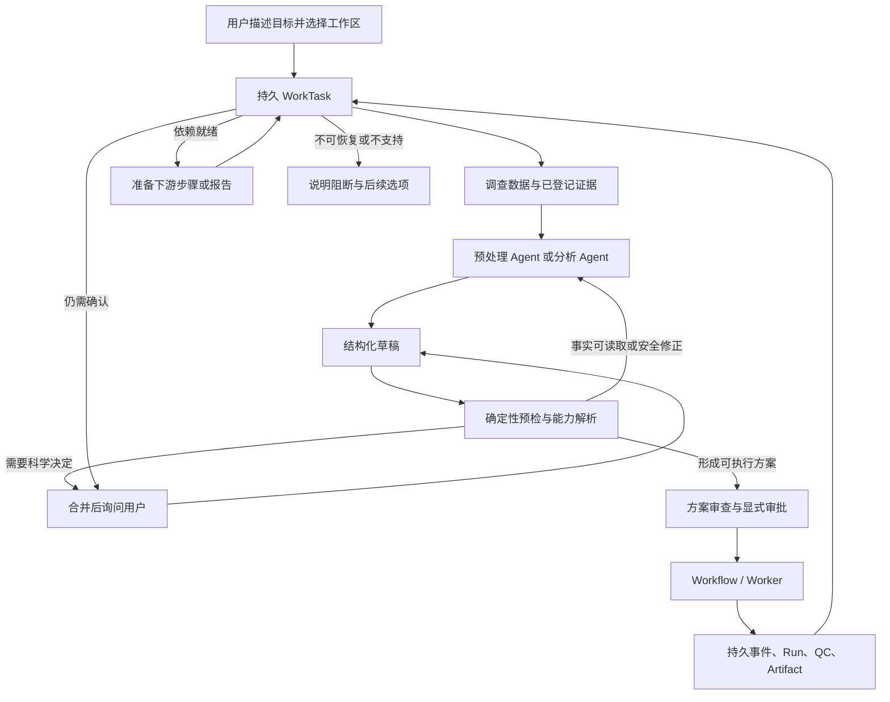

# Agent 通用自动化运行架构方案

- 状态：Implementing
- 文档类型：Architecture
- 维护者：system_architect
- 创建日期：2026-10-12
- 更新日期：2026-10-12
- 关联：[系统设计](system-design.md)、[Skill 层架构](fmri-skill-layer.md)、[计划 0014：静息态 fMRI Agent 通用自动化体验](../plans/0014-general-agent-automation.md)、[MVP 验证与已知限制](../development/mvp-verification.md)

本文定义 Agent 如何围绕静息态 fMRI 的预处理和统计分析目标，持续完成调查、方案准备、校验、等待、恢复和结果交付。它描述应保持的架构边界，不表示计划 0014 中的所有能力已经实现；具体实现状态以计划 0014 和验证记录为准。

## 设计结论

通用自动化不依赖一个无限运行或拥有完整权限的 Agent。系统由两个有界循环配合：一次请求内的反馈循环负责理解、读取证据、形成提案并修正可修正的问题；持久任务循环负责跨消息与异步运行保存目标、等待权威状态变化，并决定下一项允许的步骤。前者结束后释放模型资源，后者在事件或用户输入到达时恢复。

Agent 负责理解目标、选择已登记的能力、解释证据和提出结构化草稿。确定性服务负责输入事实、科研规则、状态转换、并发控制、授权、执行和产物登记。Agent 可以生成建议，不能凭空扩大系统能力，也不能把工程恢复变成科学方法变更。

## 端到端数据流



一项用户目标在满足其完成条件、需要用户决定、遇到当前能力边界或被取消时收口。Workflow 是实际科研运行的执行真源；WorkTask 只保存目标推进所需的引用、等待条件与恢复位置，不取代 Plan、Approval、Run、QC 或 Artifact。

## 两类循环和各自边界

### 请求内反馈循环

```text
观察已授权事实 → 生成/修订结构化草稿 → 确定性预检 → 反馈、询问或收口
```

此循环服务于当前交互。可自动补查的事实应从授权的数据目录、项目元数据和已登记产物读取，并保留来源与可信级别。预检指出问题后，Agent 只能在未批准草稿上做有界修订，并重新运行同一组确定性校验。修订与工具调用共享一次请求的步数、token 和墙钟预算；相同草稿、证据和错误反复出现时停止。

### 跨请求持久任务循环

```text
保存目标与步骤 → 执行一个已授权动作或进入等待 → 收到用户/运行事件
→ 重新读取权威状态 → 校验等待条件 → 决定下一步或收口
```

此循环服务于长时间及多步骤科研工作。等待 MATLAB、Worker、QC 审查或用户决定时，不持续轮询模型，也不保留一次性执行授权。运行事件只负责唤醒；恢复时通过应用端口重新读取 Run、QC、Artifact 和输入修订。若状态或版本发生变化，旧草稿不得覆盖新事实，必须重新预检或请求用户决定。

两个循环都应有明确预算和停止原因。持久任务不意味着无限重试：只允许对已分类的瞬时基础设施失败做有限重试，复用现有 Worker 的 attempt 与租约；任务控制器不得为同一个失败 attempt 擅自创建新科研运行。

## 分层职责

| 层 | 负责内容 | 明确不负责 |
| --- | --- | --- |
| Work 界面与 API | 接收用户目标、工作区选择、必要决定；呈现草稿、等待原因、运行状态和结果 | fMRI 科学规则、直接执行脚本 |
| 对话与 Agent | 目标理解、预处理/分析角色选择、结构化提案、证据解释和报告叙述 | 写权威状态、审批、任意文件或命令执行 |
| 应用编排 | WorkTask 生命周期、用例与事务、能力服务协调、预算和版本冲突处理、用户决定汇总 | 重新实现领域校验或复制运行状态 |
| fMRI 领域与 Skill | 指标、输入身份、科研约束、方案适用性、参数和产物合同、校验结果 | API、数据库、模型 Provider、MATLAB 进程 |
| 方案编译与执行计划 | 将已校验的逻辑步骤映射到受支持的物理执行单元、依赖和检查点 | 把逻辑节点宣称为实际可暂停的 MATLAB checkpoint |
| Workflow、Worker 与执行器 | 运行领取、租约、attempt、取消/超时、DPABI 调用、日志与产物注册 | 推断用户目标或替用户选择科研方法 |
| 持久化与文件基础设施 | SQLite 事务与版本、事件、证据引用；受控工作区读写和内容哈希 | 代替领域规则判断证据科学含义 |

依赖方向保持单向：界面/API 调用应用用例；应用层依赖领域服务和窄持久化/执行端口；基础设施实现这些端口。Provider、文件系统或 SQLite 的细节不应渗入领域对象。模块化单体和共享事务足以支撑当前本地单用户场景，是否拆分进程或服务需由实际并发与部署需求驱动。

## 权威状态与任务记录

| 对象 | 权威信息 | WorkTask 可保存的内容 |
| --- | --- | --- |
| 任务目标 | 用户描述及明确更新 | 目标摘要、完成条件、当前步骤和恢复位置 |
| 输入事实 | 工作区、manifest 与登记的 Artifact/lineage | 引用 ID、revision/hash、待补证据列表 |
| 预处理或统计方案 | 不可变 Plan/Design revision | 当前草稿或已批准 revision 的引用 |
| 用户决定 | 追加式 Approval/QC review 记录 | 等待的决定类型及关联对象引用 |
| 执行 | Workflow Run 及其 attempt/event | Run ID、等待条件、最近消费的事件标识 |
| 输出 | 已登记 Artifact、QC 和报告 | 目标所需产物类型与它们的 ID |

WorkTask 状态表达的是编排等待状态，例如 `waiting_user`、`waiting_run`、`waiting_dependency`、`blocked`、`completed` 和 `cancelled`。它不保存一份可独立演化的“Run 状态”或“QC 结论”。事件必须通过绑定对象校验、幂等消费和版本控制；乱序或重复通知触发一次权威重查，不能用过期 payload 覆盖当前事实。

## fMRI 能力与方案生成

自动化应以版本化、声明式的 Skill/能力合同为基础。每项能力需要声明输入身份和证据等级、前置状态、必须参数、科学含义、允许的配置范围、输出 Artifact/lineage、QC 条件、受支持的软件接口、执行单元策略及验证成熟度。名称相似或文件扩展名相同不能证明输入适用。

方案解析按以下顺序进行：

1. 从工作区清单调查 subject/session/run、采集元数据、已有中间数据、指标图像、人口学表和历史产物；只在授权范围内读取。
2. 给每项推断保存来源与级别：已由执行器核验、用户声明、候选推断或未知。冲突证据保持冲突，不能悄悄提升为已核验。
3. 依据目标指标和真实输入状态查找已登记的 Skill/能力路径，例如原始数据、合格的中间时序或已存在的指标文件。
4. 构建受限逻辑依赖图，检查输入、方法、参数、空间、mask、样本集合与已有 Artifact 的 lineage 是否满足合同。
5. 把逻辑方案编译为当前 DPABI/Worker 真正支持的一个或多个执行单元；明确一次调用内部不可暂停的范围、调用前后检查、重试边界和可复用的已核验结果。
6. 向用户展示方案摘要、关键决定、预计生成的产物和未解决风险；方案或输入 revision 改变后，旧批准不再适用。

预处理与分析 Agent 可以各自保持角色上下文和草稿，但自动交接依赖结构化任务和服务端证据引用。分析所需指标尚不存在时，任务可以等待上游预处理运行完成，再由编排服务读取新登记的指标并准备分析草稿；不能靠模型猜测运行结果或绕过 QC/审批门。

## 问题处理与自动恢复策略

| 问题类别 | 自动化行为 |
| --- | --- |
| 授权范围内存在的元数据或登记事实 | 自动读取、记录出处、重新预检 |
| 不改变科学语义的确定性格式/结构问题 | 生成受限草稿修订并重新校验；保留修订差异 |
| 需要方法学选择或纳入/排除决定 | 汇总相关问题，说明各选项依赖的证据，等待用户明确选择 |
| 证据冲突或来源等级不足 | 保留多个来源及差异；不得通过多数投票或模型信心消解 |
| 输入、方案或工作区 revision 已变化 | 使依赖旧版本的草稿和确认失效，重新调查与校验 |
| 重复/乱序事件或并发写入 | 幂等消费并读取当前权威记录；版本冲突时不覆盖较新状态 |
| Worker 瞬时错误 | 按现有 attempt/retry 策略有限恢复并保留日志；耗尽后进入可解释阻断 |
| 不支持的能力或 DPABI 映射缺失 | 执行前阻断，指出缺少的能力合同或证据，不编造脚本 |
| 统计校验失败或没有显著结果 | 解释准确的设计问题或有效零结果；不自动换方法、阈值或对比 |

每条问题都应能追溯到具体数据、输入版本、校验规则或运行事件，并有稳定的问题类别和停止原因。自动修复范围来自注册的规则，不来自 Agent 的自由发挥。

## 面向用户的自动化体验

用户应该能够以一个目标开始，例如“检查这个工作区，准备计算 ALFF 和 ReHo；对现有指标做两组统计并生成报告”。系统先读取所选工作区中可读的事实，再把影响科学结论的未知项集中询问。用户审查并批准方案后，系统负责创建受控运行、等待进度、消费完成事件、检查 QC 与产物，并在目标条件满足后准备下一步或整理结果。

界面应区分四种结果：正在自动调查/恢复、等待用户科研决定、等待长作业或 QC、当前能力不支持/执行失败。用户断开页面不应清除任务进度；重新打开时应看到已完成的检查、当前等待条件、最近错误与继续所需操作。成功统计即使没有显著簇，也应生成正常的结果解释和复现材料。

自动化质量用支持范围内的目标完成率、技术性追问轮数、重复询问已核验事实次数、可恢复故障恢复率、重复运行次数、重启恢复率、用户决定等待时间和每个目标的资源预算衡量。需要科学决定、能力不支持、安全拒绝和未完成运行应单独统计，不能通过从分母删除困难任务来虚增自动化比例。

## 适用边界与演进路径

本架构不承诺“任何自然语言目标、任何数据目录、任何指标、任何 DPABI 安装”都可自动执行。支持边界由当前已核验的输入合同、Skill、统计设计、执行适配器和产物检查共同决定。对 FC、复杂多 session/run、重复测量、批量 checkpoint 或未知预处理史，必须先具备完整身份、设计、执行和证据合同。

实现按垂直切片演进：先统一结构化预检与有界反馈；再完成持久任务恢复和事件唤醒；随后扩展输入身份与可审查的外部导入；接着建立从逻辑科研步骤到真实 DPABI 执行单元的映射；最后逐项增加指标和统计方法。任务清单、场景与验收证据维护在[计划 0014](../plans/0014-general-agent-automation.md)，验证事实维护在[MVP 验证记录](../development/mvp-verification.md)，重大且不可逆的状态与权限边界通过 ADR 决策。
