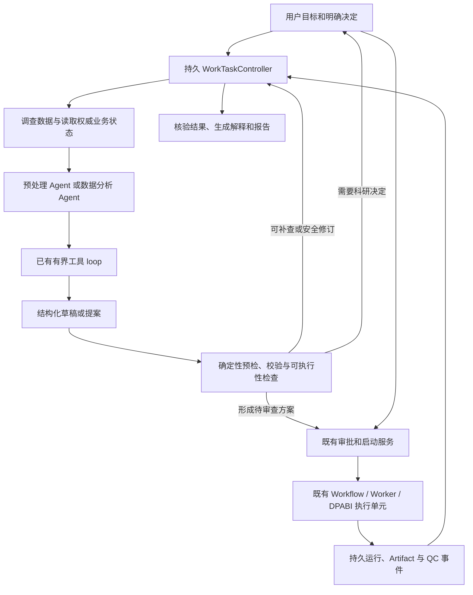

# 计划 0014：静息态 fMRI Agent 通用自动化体验

- 状态：Implementing
- 文档类型：Plan
- 维护者：system_architect
- 创建日期：2026-10-11
- 更新日期：2026-10-21
- 关联：[MVP 验证与已知限制](../development/mvp-verification.md)、[Skill 层架构](../architecture/fmri-skill-layer.md)、[Work 双 Agent ADR](../adr/0024-work-dual-agents.md)、[Agent 控制面 ADR](../adr/0015-agent-control-plane-hardening.md)、[DPABI 单次预处理 ADR](../adr/0021-single-pass-dpabi-preprocessing.md)、[ADR 0036](../adr/0036-persistent-work-task-boundary.md)、[ADR 0037](../adr/0037-fmri-input-identity-and-evidence.md)、[ADR 0038](../adr/0038-logical-plan-to-execution-units.md)、[ADR 0039](../adr/0039-work-task-reconciliation-worker.md)、[ADR 0040](../adr/0040-preprocessing-task-output-completion.md)、[ADR 0043](../adr/0043-shared-worktask-step-lifecycle.md)、[ADR 0044](../adr/0044-worktask-step-readiness-handlers.md)、[ADR 0045](../adr/0045-bounded-linear-worktask-step-scheduling.md)、[ADR 0046](../adr/0046-composite-goal-foreground-selection.md)、[ADR 0047](../adr/0047-frozen-analysis-goal-restoration.md)、[ADR 0048](../adr/0048-composite-goal-model-call-budget.md)、[ADR 0049](../adr/0049-analysis-only-external-import-goals.md)、[ADR 0050](../adr/0050-analysis-only-result-continuation.md)、[ADR 0051](../adr/0051-analysis-only-foreground-resume-and-new-goals.md)

## 目标里程碑

在现有预处理 Agent、数据分析 Agent、Skill、审批和 MATLAB Worker 基础上，建立能跨消息和运行事件持续推进的任务流程；让系统先调查数据、检查可执行路径，再集中询问必要的科研决定；让可恢复的工程阻断进入有界恢复过程；把逻辑科研步骤与 DPABI 实际执行单元对应起来。

计划交付后，在已声明支持范围内，用户无需逐步指导 Agent 读取什么、切换哪个角色或计算结束后说“继续”。用户仍保留科研方案审查和当前规定的执行/QC 决策权。

本计划不增加第三个模型协调 Agent，不迁移现有模型框架，不允许模型执行任意 MATLAB/Shell，不以自动改变科学方法、排除样本或追求显著结果来提高完成率。

计划 0013 已完成的双 Agent、交接、统计、结果解释和报告功能是本计划的复用基线，不在本计划重复实现。能力扩展应纵向贯穿输入、设计、执行、证据与结果，并分别验收。

## 验收标准

1. 单个用户目标有独立、持久的推进状态；页面关闭、API 重启或重复/乱序运行事件不会丢失状态或重复创建计划、审批、作业。
2. Agent 的草稿经过应用服务的结构化预检。能从授权来源读取的事实由系统补查；存在明确、安全的草稿修订时可在共享预算内重新校验；无进展时停止并说明具体阻断。
3. 任务状态不复制或替代 PlanRevision、ApprovalRecord、WorkflowInstance、QC 和 Artifact 的事实来源；后台恢复不借用前台角色或旧的一次性授权。
4. 等待 MATLAB/Worker 时不持续调用模型。运行事件唤醒任务后，系统重新读取权威状态，再决定准备下游草稿、报告、等待用户或终止。
5. 预处理逻辑 DAG 清楚标出合并的一次 DPARSFA 调用、调用前后检查、可复用的已核验 checkpoint，以及实际不可暂停的执行边界。
6. 数据目录或元数据缺失时，系统可以自动检查安全范围内的证据，并把无法判断的事项按来源呈现。未知事实不会默认为已验证。
7. 单组、配对、表驱动分组、多 run/session、metric-only 和批量 checkpoint 的支持范围在生成计划前可判定；未实现组合会在提交计算前返回能力边界。
8. QC、输入变化、mask/空间不匹配、统计设计秩亏、超时/重试、零显著结果等均符合本计划的场景验收矩阵。
9. 真实统计方法、纳入名单、排除决定、阈值、尾部和协变量不会因自动恢复被静默更改。零显著结果按成功分析收口。
10. 新能力有确定性领域与故障验证、Mock 应用交互验证，并按用户单独授权完成相应真实 Provider 或合成 MATLAB 验收。三类证据分别报告，不以 Mock 代替真实科学执行或模型质量评估。

## 当前基线与问题

当前已有有界模型工具循环、READ/PROPOSE/EXECUTE 权限隔离、预处理和分析角色独立草稿、计划审批、SQLite 幂等与 Worker 重试/租约恢复。受控 MATLAB 模板、DPABI 适配器、输入哈希和实际产物检查也已具备，作为可信执行基础保留。

需要补足的边界：

- Agent loop 在一次模型请求内迭代读取；Work 对预处理/分析草稿提案动作提供有限的同轮预检修订。预处理 Skill 编译与 Work 统计设计装配已分别接入只读 dry-run，但执行前校验尚未统一成通用“反馈—补查—重验”应用服务；分析中的科研缺项继续等待用户决定。
- `ConversationWorkTaskView` 继续保存前台角色指针；独立 `WorkTask/TaskStep` 已开始承载用户目标、等待条件、完成条件和权威引用，并纵向接入预处理 Plan 与统计提案/Plan/Run。现有 Worker 已接入带独立租约和 fencing token 的启动/周期扫描，可重核 Run、QC 决策和统计结果等待；目标预算累计、完整步骤恢复和下游自动准备仍未完成。
- 双向 handoff 记录和角色路由已实现；分析缺少上游指标时仍可能让用户手动切换角色继续。已能对已绑定运行、QC 决策、冻结预处理目标产物和统计结果做自动重核；显式复合请求可经持久 outbox 自动准备统计草稿。用户现在可以明确选择一个预处理 WorkTask/Run，为同一来源登记多个独立分析目标；真实统计结果解释也可由独立 outbox 自动续接。把单条自然语言自动拆成多个目标及更广范围的完整目标恢复仍待实现。
- `SkillResolver` 以有限指标组合选择 Skill。数据扫描能够看到的实体、session/run 和已有中间阶段与执行器实际支持范围仍有差距。例如主预处理单 session，metric-only checkpoint 目前限单主体。
- 外部指标目录仍以显式组/条件导入为主；单组目录现可登记为一个纳入组并进入单样本候选，但多 session/run、人口学表驱动纳入和复杂重复测量结构仍未覆盖。
- Skill 的逻辑步骤不能自动推导出 DPABI 的物理暂停点。当前主模板为一次 `DPARSFA_run` 调用，并在执行后检查实际产物；已有受控 checkpoint 输入复用不等于任意失败节点都能断点续跑。
- 一些限制属于当前已审核 Skill 或实现能力边界，不能统称为 fMRI 科学硬规则。预检必须显示错误类别与补救候选。

主要代码入口：`neuroagent/agent/loop.py`、`neuroagent/application/service_mixins/conversations.py`、`neuroagent/application/work_dialogue.py`、`neuroagent/application/work_tasks.py`、`neuroagent/application/work_handoffs.py`、`neuroagent/skills/resolver.py`、`neuroagent/skills/models.py`、`neuroagent/domain/fmri/artifacts.py`、`neuroagent/execution/preprocessing.py`、`matlab/templates/run_preprocessing.m.tmpl` 和 `neuroagent/infrastructure/matlab_executor.py`。验收事实以验证文档最新记录为准。

## 架构优化决策与落地顺序

本计划的核心诊断是：当前体验的主要断点不是一次模型请求里缺少更多推理轮数，而是没有一条完整、持久的应用流程把用户目标、预处理/分析角色、方案审批、Workflow Run、QC、Artifact 和报告连接起来。请求内有界工具循环已经能解决局部“读取—提案—校验—修订”；它不能单独承担 MATLAB 长时间等待、用户离开页面、服务重启、跨角色交接和下游依赖恢复。若缺少持久的目标协调，用户就会被迫用“继续”消息手动充当调度器。

因此采用现有本地优先模块化单体，沿当前目录边界逐步补齐职责，不整体重写 Agent 框架，不先拆微服务，也不把更多决策塞进提示词。职责与改造落点如下：

| 边界 | 负责的工作 | 本计划中的落点与约束 |
| --- | --- | --- |
| API / Work 交互 | 接收目标、工作区和用户决定；展示方案、等待原因、状态与结果 | `neuroagent/api/` 与 Work 前端只转换和呈现应用命令/查询，不直接调用模型、拼接 MATLAB 命令或修改科研状态 |
| Agent 与对话 | 解析意图、选择预处理/分析角色、读取允许的上下文、生成结构化草稿和解释 | `application/work_*` 与 Agent runtime 保持 READ/PROPOSE；模型输出必须进入 schema 和确定性预检，不能成为运行时事实 |
| 用例与目标编排 | 组织单次交互、WorkTask/TaskStep、预算、用户等待、事件恢复及跨能力协作 | `application/automation/` 持有目标推进；`WorkTask` 保存状态引用与等待条件，不复制 Plan、Run、QC 或 Artifact 的权威状态 |
| fMRI 领域与 Skill | 输入身份、指标顺序、方法学限制、适用条件、参数/产物/lineage 合同和校验 | `domain/fmri/` 与 `skills/` 提供确定性规则和不可变计划；不依赖 Provider、SQLite、HTTP 或进程执行 |
| Workflow 与执行 | 执行已批准的冻结方案，跟踪 attempt/超时/取消并登记产物 | `workflow/`、`execution/` 与固定 MATLAB 模板继续独立于对话编排；运行重试复用同一 Run/Worker 语义，不由目标控制器擅自创建新 Run |
| 基础设施与组合根 | 实现数据库、文件、模型、事件和执行端口，并装配应用 | `infrastructure/` 实现窄端口；`bootstrap.py` 只负责依赖装配，不承载科学或任务推进规则 |

两个循环必须分开实现并共享结构化合同：

1. **请求内反馈循环**在一次前台交互内受步数、token、墙钟和无进展熔断约束，负责调查可读取事实、提出/修订未批准草稿、运行确定性预检，并以“待用户决定、待审批、能力阻断或已形成草稿”结束。修订不改变科研语义；事实相同且问题未变化时停止，不反复调用模型。
2. **跨请求持久循环**由 WorkTask 与 Worker 恢复协调器驱动，只在用户输入、运行事件或到期重查时醒来。事件只是唤醒信号；恢复后重读 Run、QC、输入 revision 和 Artifact 等权威记录，再判断下一步。它不能持有旧的一次性授权，也不在等待长作业时持续调用模型。

跨循环的模型工作应采用“先验证、后生成、再 fenced 提交”的边界：应用服务先核验任务绑定和冻结输入，再在数据库事务外调用相应 Agent；最终提交前重新检查任务版本、claim/fencing token 和输入 hash。续接结果只产生可审查的 assistant 草稿或报告草稿；Plan 审批、统计运行、QC 决定仍走现有用户授权入口。任何失去租约、版本过期或证据不一致的生成结果都不得落库。此规则是阶段 B 下游续接实现的验收约束，细节与已接受 ADR 以 ADR 为准。

落地顺序按依赖从低到高推进：

1. 先统一结构化预检问题、证据来源、可安全修订范围和停止原因，让预处理与分析角色共享一致反馈合同。
2. 补全 WorkTask 的持久生命周期、事件去重/周期恢复、租约 fencing 和目标 Artifact 完成判定；将模型续接限定为证据核验后的提案生成，不让协调器代替审批或启动运行。
3. 再改善输入身份和外部指标映射，覆盖单组、表驱动分组与 session/run 配对；候选推断必须保持候选身份，不能提升为已验证事实。
4. 将 Skill 逻辑 DAG 映射为已核验的物理执行单元，标明 DPABI 调用、输入/输出、调用前后检查、重试范围及可物化 checkpoint；不把单次 `DPARSFA_run` 内部步骤描述成可暂停点。
5. 最后逐项扩展 FC、多 session/run 和统计方法。每项能力必须贯通输入、设计、执行、Artifact lineage、解释与失败恢复后才能进入可自动编排范围。

本计划明确不以“任意自然语言→自由 MATLAB 脚本”、自动替用户选检验/阈值/协变量/样本、任意 DAG 搜索、增加第三个协调模型或目录级大搬迁来提高自动化率。架构职责和数据流的稳定说明见[Agent 通用自动化运行架构方案](../architecture/agent-automation-runtime.md)；本节只约束计划 0014 的实现顺序与评审边界。

## 目标流程

任务控制器是应用层确定性服务，不运行第三个模型。它推进用户目标；WorkflowInstance 仍是科研作业状态唯一真源。Worker 继续负责作业领取、attempt、租约、有限重试和终态。模型仍只能 READ/PROPOSE；真实执行、QC 和审批继续经过现有服务与授权入口。

## 实施阶段

### 阶段 A：结构化预检与有限的校验反馈

当前状态：结构化反馈合同、预检上下文及 Work 两角色的同轮回路已接入。预处理未批准草稿（包括首轮尚未持久化的候选）可通过只读 `SkillResolver → SkillValidator → SkillCompiler` dry-run；Work 统计候选调用正式 proposal assembler，并复用来源绑定、完整 lineage、源文件哈希、校正/设计矩阵及 Skill 参数 schema 校验。文件核验后会重读项目及 manifest/外部纳入修订。预处理通用问题指纹绑定候选草稿修订与对应证据值，只有相同草稿和证据的重复问题才因无进展停止；变更后的候选可使用本轮剩余预算重新校验。两类 dry-run 只证明结构与来源预检通过，不证明真实影像或统计可执行，不探测本机软件，不创建 Plan、Approval、Run、事件、授权或任务。tail、missing-value policy、校正方式（含显式 `none`）及协变量中心化必须来自明确选择；无法证明的旧草稿默认值按未决项进入 `ASK_USER`，不由反馈环自动补齐。科研决定和来源冲突交给用户，能力缺口明确停止。该 Stage A 垂直切片已完成；统一执行前反馈服务、编译/审批后的再次重核、跨轮稳定 intent 进度聚合等仍未完成，阶段 A 整体仍为部分完成。

目标是先减少一轮对话内不必要的人工技术排错，不启动跨消息后台循环。

任务：

- 定义统一 `PlanningIssue`：问题类别、影响对象、缺失证据、来源、允许的修复候选、是否改变科学语义、所需用户决定和是否可重试。
- 把 Skill 编译和统计草稿检查以 dry-run/预检形式暴露给相应角色。预检不得创建批准、Run、MATLAB 进程或改变用户选择。
- 模型可选择的修复仅来自已注册的 READ 工具和未批准草稿修改，不接受自由命令、自由 MATLAB 文本或任意文件写入。
- 有可读元数据时自动读取并重新校验；需要研究者判断时合并问题；同样证据、同一失败反复出现时停止。
- 保持当前一次请求的步数、token 和墙钟总预算在工具调用、修订与结构回退间共享。
- 记录一项预处理缺采集元数据场景和一项统计草稿校验阻断场景。

主要落点：`application/work_dialogue.py`、`application/work_draft.py`、`application/statistics_draft.py`、`skills/models.py`、相应预检服务及角色只读工具。

完成条件：可读取事实不会再作为人工抄录问题；不可修复或涉及科研决策的问题有精确说明；旧确认不能应用到新草稿；达到预算/无进展时能收口。

### 阶段 B：持久任务推进与事件唤醒

当前状态：已完成 WorkTask/TaskStep 模型、SQLite schema/repository 和应用服务组合接线；事件消费有任务 Run 引用核对、去重回执、单调游标及乐观版本控制。`reconcile_waiting_run(task_id)` 已接入 Event、Run、QC 与 Artifact 现有应用端口：事件只提供去重身份和唤醒信号，之后重读权威状态。读取 Run/QC/Artifact 期间以 Run `version` 前后夹读；最多重试三次，持续变化时返回 `indeterminate` 并保留任务生命周期状态。运行中或 Worker 可重试状态保持等待同一 Run；`QC_REVIEW` 中 `pending`/`awaiting_review` 且审查记录尚无或为 `draft` 时，以及 `failed` 且最新审查为 `draft` 时转为 `waiting_user`；`failed` 缺少审查或状态与审查记录不一致时阻断。通用 Artifact 引用按 ID 解析并校验项目归属，可来自上游 Run。预处理成功且 QC 已批准或显式跳过时，会按冻结 SkillPlan/manifest 推导的精确目标集合检查类型、路径、受试者、缩放、校验和及 lineage；全匹配后原子完成步骤与 WorkTask，缺失或矛盾时阻断。统计结果仍按类型专属合同核验。Worker 仅额外恢复绑定同一 Run 的预处理 `downstream` 旧等待；普通 dependency 不进入领取范围。协调器不读事件 payload、不调用模型、不写 Plan/Approval/Run、不创建 Run，也不自动审批 QC。复合请求现可经持久 outbox 自动准备 proposal-only 统计草稿，并在真实 StatisticalResult 登记后自动续接结果解释草稿；二者都不替用户审批设计或启动统计运行。多目标恢复仍未实现，因此本阶段尚未达到完整跨步骤自动化验收。

阶段 B 提案续接 outbox（2026-10-14）：显式 `preprocess_then_analyze` intent 现在会在其预处理任务绑定冻结 Plan、manifest 与 Run 后创建唯一、幂等的 proposal-only outbox；请求正文仍只存在于会话 intent 消息，outbox 保存 intent ID 和正文 hash。只有冻结目标 Artifact 全部核验通过时，预处理任务完成与 outbox `pending → ready` 才在同一 SQLite Unit of Work 提交，并绑定精确核验过的 Artifact IDs。READY outbox 支持短租约和递增 fencing token。独立消费 Worker 会在模型调用前重新核验会话/项目、intent、Task/Plan/manifest/Run/QC、目标 Artifact 与 lineage；精确 allowlist 只包含这些目标 Artifact 及已核验的 lineage mask 依赖。模型在事务外调用，最终 assistant-only continuation、分析 WorkTask/提案和 outbox 终态在同一 UoW 以 fencing token 原子提交；重复消费幂等，证据在模型调用期间变化或租约失效会丢弃模型结果。模型只收到 QC、指标类型与数量、受试者数量及 mask 数量等有界摘要；逐项 Artifact ID、路径、checksum 与 lineage 不进入模型上下文，统计 assembler 继续使用服务端 allowlist。草稿需用户决策时进入 `WAITING_USER`，短暂错误有界退避并提供人工重试入口；硬证据冲突终态阻断。页面按 retry generation 恢复人工重试后的轮询，并隐藏过期一代的重试按钮。运行终态会立即刷新会话；成功运行仍有待续接 intent 时，页面立即读取并按指数间隔补读（1 秒起步、上限 60 秒），最多 16 次查询，覆盖至少 10 分钟后停止或在收到 continuation 时立即停止。消费者不阻塞现有 workflow job/reconciliation，不伪造 user message，不创建/批准统计 Plan 或 Run，也不运行 MATLAB。预处理-only 请求不会创建续接记录。具体合同见 [ADR 0041](../adr/0041-proposal-only-analysis-continuation-outbox.md)。

### 阶段 B 真实统计结果解释续接（2026-10-14）

统计结果登记晚于 Run 成功时，既有周期 reconciler 继续等待并重核权威记录；只有类型化 WorkTask 完成器核验到唯一、真实、非 synthetic 的 StatisticalResult 及其冻结 bundle 和全部 Artifact lineage 后，才在同一 Unit of Work 原子完成任务并写入独立的结果解释 outbox。此 outbox 不与 ADR 0041 的分析提案队列共用。结果解释消费者拥有独立租约/fencing，模型调用前后均重读 WorkTask、会话、Run、Plan/design、StatisticalResult 和 Artifact 证据；提交只允许 assistant-only 解释/报告草稿，并与 outbox 终态在同一事务收口。模型上下文由白名单统计摘要和确定性 readout 组成，对标签、文本和数组做字段级限长/限量，不传完整报告、subject-level 矩阵、逐 Artifact ID 或路径。零显著结果正常解释；synthetic/mock、来源冲突或无法验证的证据不调用模型；空间未知时不虚构定位。可恢复失败提供独立幂等重试 API 与 generation-aware 页面轮询。该切片不创建或批准 Plan、不创建或启动 Run、不修改科学决策；它完成了单个已完成统计 WorkTask 的结果草稿续接，不代表本计划的多意图、通用下游步骤或整体阶段 B 全部完成。合同见 [ADR 0042](../adr/0042-statistical-result-interpretation-outbox.md)。

### 阶段 B 单个复合目标关联与进度投影（2026-10-15）

当前垂直切片为明确的 `preprocess_then_analyze` intent 建立 identity-only 根记录，并与预处理 WorkTask 创建/保存共用 Unit of Work，因此目标可早于分析 proposal outbox 存在。根只保留 conversation/project、原始请求 hash、预处理 task、可选 proposal/result outbox 和当前分析 task 的稳定引用；proposal hash 修订通过仅含 attempt 序号、task ID 和 proposal hash 的尝试表保留历史，不复制 WorkTask 或 outbox 状态。首个 proposal outbox 继续指向首次自动提案任务；用户修订后可有不同 active task，迟到的旧 task 不能重新激活或绑定结果 outbox。

只读 snapshot 在同一 SQLite read transaction 读取根、会话/Plan project 证据、两类 outbox、所有分析尝试、WorkTask 和结果解释 assistant continuation。只有 active task、结果 outbox、completed assistant 消息，以及消息 payload 中的 task/status/result ID/version 完全一致，投影才返回 `completed`。应用服务按 conversation ID 列出目标并复用单目标投影，验证 WORK 会话、Task 与 Plan 项目；`GET /api/v1/conversations/{conversation_id}/composite-goals` 不接受裸 intent ID，对 Chat、缺失会话或越项目关联失败关闭。Work 页面以中文呈现预处理、分析方案、统计分析、结果解释四个环节；切换会话时取消旧请求并丢弃迟到响应，活动目标每 10 秒刷新、终态停止，查询错误单独提示并可手动重试。页面不展示内部 ID，也不推断科研方案。目标列表暂不包含用户原始意图标题，多条目标仅按顺序编号。本切片仅支持单个显式复合目标，不是通用调度器或多目标 fanout。

迁移 0028 对历史任务仅在 Task/Step、WORK conversation、project/Plan/manifest，以及存在时的 proposal outbox/首个 analysis task 精确匹配时回填；歧义或相互矛盾的旧关联不导入，等待显式恢复。定向测试覆盖预处理任务建立时 root 已持久化且 outbox 为空、首个 outbox/task、修订 attempts、迟到旧尝试、精确结果 outbox 绑定、assistant continuation 错配 fail-closed、迁移歧义跳过，以及 API 空列表/会话隔离/非 Work 和跨项目拒绝。前端测试覆盖状态呈现、独立错误、会话切换竞态、取消与人工刷新。阶段 B 整体仍未完成；当前仅提供单会话显式复合目标进度读取，通用多步骤恢复、多目标 fanout 与用户意图标题呈现仍待实现。

本切片验证：相关后端 8 个模块 100 项通过，Agent 页面 45 项通过，Ruff、Mypy、TypeScript、全站 ESLint、生产构建、OpenAPI exporter 与文档标准检查通过；未运行 MATLAB/DPABI。全量前端 Vitest 为 174 项通过、50 项失败，失败集中在其他既有页面/组件测试的相对 `/api/...` URL 被 Node fetch 解析失败；该全量门禁仍需单独修复，不能以本切片定向通过替代。

### 阶段 B 多意图共享预处理来源的 fanout 基础（2026-10-15）

迁移 0030 移除了每个预处理 WorkTask 只能关联一个 CompositeGoal、以及每个预处理来源只能有一条 analysis proposal outbox 的唯一约束，保留 intent ID 和每个目标 outbox 的唯一性，并增加来源查询索引。迁移保留既有根、outbox、分析 attempt、索引与触发器；如果降级时已有多个目标共用来源则拒绝降级，避免丢失无法由旧 schema 表达的数据。0028 的历史保守回填未改变。

应用层现按稳定的 intent ID 顺序读取某一预处理 WorkTask 的 outbox。预处理目标产物通过类型化 readiness 核验后，在既有完成 Unit of Work 中逐条核对 Task、会话、项目、冻结 Plan、manifest、Run 与原始 intent hash，只把仍为 pending/ready 且完全匹配的记录置为 READY；缺失或错误来源单独跳过，不阻断其他有效目标。同一预处理 WorkTask 可被多个 identity-only CompositeGoal 引用，进度投影仍读取共享 WorkTask 的权威状态，不复制任务生命周期。

在下面的“显式来源注册与前端接线”切片完成前，上游仍没有面向用户的共享来源注册入口，也不能把同一自然语言请求自动拆分成多个独立分析目标。该基础切片本身不构成多指标自动分析体验，也不放宽用户对统计方案审查和 Run 授权的决定权。

本切片相关后端定向验证 77 项通过；Mypy 300 个源文件、Ruff check/format 与 `git diff --check` 通过。没有运行 MATLAB/DPABI。

### 阶段 B 显式来源注册与前端接线（2026-10-15）

Work 页面现在只在会话绑定到当前工作区/项目，且存在带精确 `work_task_id` 与 `run_id` 的预处理目标时，显示“以指定的预处理结果新建分析目标”选项。用户必须主动勾选并从空选择器中明确选定来源；页面不默认使用活动或最新 Run。提交会携带 `preprocessing_task_id`、匹配的 `target_run_id` 和分析角色；普通分析交互不发送预处理任务身份。

后端只接受 Work 会话中的 `ANALYSIS + AUTO` 请求，并核验会话、项目、唯一预处理步骤、Task/Step、冻结 Plan、manifest 和精确 Run。该入口不调用普通对话模型来猜来源；它将用户原始分析请求持久化为独立 intent，并在同一 SQLite Unit of Work 中追加会话消息、创建 CompositeGoal root 和 proposal outbox。共享来源上的每个 intent 均有独立 outbox 和身份；完成时复用已有 fanout，统计 WorkTask 身份按 intent 隔离。

运行中的预处理来源登记为 PENDING，完成时由既有收口流程核验后置为 READY。已完成来源仅在稳定 Run/QC/Artifact 快照及 completion evidence 通过后直接 READY；finalize 会再次核对来源版本、Artifact IDs 与 lineage fingerprint。来源在准备与提交间变化时，事务回滚消息和 outbox。outbox consumer 仍会在模型调用前后复核来源，且只生成可审查的统计方案草稿；统计 Plan 审批和 Run 启动仍要求原有用户决定。若 Run 已成功但 WorkTask 尚未由 reconciler 收口，当前仍等待其 completion fanout。

这条路径支持用户显式注册多个独立分析请求，不会自动拆分一条自然语言中的多个指标/统计目标，也不是通用 CompositeGoal 调度器。验证覆盖了来源绑定与证据失败、prepare/finalize 间 Artifact 变化和事务回滚、幂等重放、共享来源 fanout，以及前端显式选择/普通请求隔离。后端六个相关模块共 41 项通过，Agent 页面测试 48 项通过；Ruff check/format、Mypy（6 个变更源文件）、前端类型检查、ESLint、生产构建和文档检查通过。验证期间也修正了 handoff 限额与 stream 测试中的过时依赖接线，并为分析反馈异常补上受控错误收口，避免审计字段未初始化导致 500。未运行 MATLAB/DPABI。

### 阶段 B 分析目标摘要与继续交互审查（2026-10-16）

流程卡片现在显示来自精确持久 intent 消息的 `analysis_summary`。同一 SQLite snapshot 读取候选消息，只有可唯一核验的原请求同时匹配 intent、会话、项目、任务种类与请求 hash 时才返回摘要；相同请求的后续快照可以重复，不因续接和修订而隐藏标题。摘要折叠空白，长度不超过 160 字符。旧记录缺失精确证据或请求身份无法唯一核验时返回空值，不从最新角色指针猜测标题。此前“目标列表暂不包含意图标题”的记录描述的是当时切片，本项已补齐该显示能力。

2026-10-17 已修复 consumed 分析草稿的跨轮身份继承：用户补充或连续修订保留精确 intent/request hash，原始请求、草稿哈希及唯一来源续接不一致时受控停止；其他目标的完成 envelope 不影响当前草稿。来源绑定不依赖预处理角色当前选择的另一运行，分析补充中出现 ALFF 不会误建预处理目标。多个目标的明确选择、后台前台隔离及 Plan/Run 恢复仍需独立验收；阶段 B 尚未完成。

### 阶段 B 未冻结分析目标选择（2026-10-17）

按 [ADR 0046](../adr/0046-composite-goal-foreground-selection.md) 增加会话内精确目标选择，角色槽持久保存 intent 指针，无数据库迁移。入口只接受等待用户处理、当前尚无 Plan/Run 的分析目标；恢复最新草稿，完整提案保留原消息 ID，不完整修订清除旧提案资格。后台不同 intent 仍完成其消息/任务/outbox 提交，但不覆盖前台；草稿、来源上下文、历史和交接使用同一目标范围。统计冻结对复合目标强制核对提案消息 ID，防止相同 proposal hash 的跨目标竞态。

本切片不恢复已有 Plan/Run 的目标，也未实现通用多目标 dispatch 或完整步骤调度。累计模型预算由下方独立切片覆盖两个后台续接 outbox；前台建根前及尚未接入阶段仍有缺口。阶段 B 仍为部分完成；真实模型与 MATLAB 验收需独立证据。

### 阶段 B 冻结分析目标恢复与只读查询（2026-10-17）

按 [ADR 0047](../adr/0047-frozen-analysis-goal-restoration.md) 扩展同一目标选择入口：从冻结 Plan 的 `work_context.proposal_message_id` 恢复原提案、草稿和精确 Task/Plan/Run 引用，并核验当前 active attempt、Task/Step、设计与来源哈希。draft、awaiting approval、approved、已绑定运行、等待结果和完成状态均可在权威证据匹配时恢复；选择只改会话的 analysis 角色引用、前台角色与 active Run 投影，不创建或修改 Plan、Approval、Task、Run 或统计结果。

冻结目标的自然语言与显式 READ 查询进入同一只读入口：结果、进度和 QC 读取按选中统计 Run 收口；无 Run 时返回冻结方法与尚未启动状态，拒绝携带其他运行 QC ID。模型不接收设计矩阵、逐受试者路径或值，工具循环关闭，执行上下文只允许精确选中的统计 Run；模型产生的分析/草稿修改被丢弃。切换目标、请求来源冲突、历史身份不完整或冻结记录改变时失败关闭。前端恢复仍按绑定 Plan/Run 读取，错误不退化为新建方案或启动操作，晚到响应不能覆盖新选择。

新增冻结选择与只读回归 43 项通过，覆盖六类生命周期状态、身份错配、后续草稿与只读快照、精确 Run 结果读取、无 Run 不触发项目级结果查询、显式进度保留分析角色，以及拒绝跨 Run 查询。完成态夹具只核验持久身份，不声称生成真实统计结果。前端 AgentPage/提案操作定向测试 73 项通过，TypeScript 和相关四个文件的 ESLint 检查通过。验证使用合成记录、Mock 模型与执行器；没有真实 Provider、MATLAB 或 DPABI 运行。该切片当时仍未完成通用目标 dispatch、累计预算、多目标自动拆分与完整多步骤调度；预算后续进展见下节。

最终相关后端回归 210 项、AgentPage 前端测试 52 项通过；Ruff、Mypy、前端类型/静态检查及构建、文档检查通过。详细验证范围与限制见 [MVP 记录](../development/mvp-verification.md)。下一步推进通用 CompositeGoal dispatch 与阶段能力注册；共享预算的前台入口和其他阶段覆盖仍需纳入该合同，并保留审批/启动门禁及已存在 Run 不重复创建的语义。

### 阶段 B 显式复合目标共享累计模型预算（2026-10-17 至 2026-10-18）

新增独立于 `CompositeGoal` 身份根的 SQLite 累计预算和调用账本（迁移 0031、0032）。新根从精确预处理 WorkTask 的 `TaskBudget` 复制上限；工具循环中每一轮和结构化单次回退在分发前原子预留步数、调用数、估算 token 与最多剩余额度的整数秒，后者限制本地 Gateway await。调用后按 token usage 幂等结算，实际观测的向上取整耗时替换 elapsed 预扣；超时取消清理可能产生 elapsed overrun 并阻止后续分发，进程退出时未结算的预扣仍保留。报告成功的 profile failover attempt 会对额外尝试按单次估算 token 收费。Reservation ID、调用 ID 在同一 intent、outbox 重试代数、claim fencing token 和单次尝试序号内稳定生成；重复预留不再次分发模型。分析提案与统计结果解释共享同一 CompositeGoal 账本，额度耗尽时 outbox 进入不可自动重试的 `WAITING_USER`，不会创建或批准 Plan，也不会创建或启动 Run；claim fence 丢失时本地生成协程会被取消。没有 CompositeGoal 根的历史 standalone outbox 保留既有消费路径。

0031 为历史 CompositeGoal 回填预算上限；0032 持久化 in-flight elapsed reservation。旧模型调用没有可核验 usage/调用账本，故迁移后历史已用额度从零开始；新根从创建时开始完整记账。当前预算只接入两个后台 outbox，不覆盖普通前台 Work 对话、建根前生成和未来通用调度阶段。Gateway 内部 profile attempts 按一次逻辑 invocation 计调用数；成功后报告的额外 attempts 会估算收费，失败且没有 usage 的隐藏 attempts 不能精确记账。本地 timeout 不能保证远端 Provider 停止处理或计费。约束与取舍见 [ADR 0048](../adr/0048-composite-goal-model-call-budget.md)。

定向后端验证覆盖持久化原子预留/结算、重放与耗尽、重启时 elapsed reservation、Gateway timeout 与迟到响应拒收、claim 丢失取消、预算缺失失败关闭、报告的 profile failover token 估算、工具循环/单次回退预算闸门、分析与结果 outbox 及 CompositeGoal 回归；通过数见 [MVP 验证记录](../development/mvp-verification.md)。Ruff、Mypy 和文档检查结果以最新验证记录为准；没有调用真实 Provider、MATLAB 或 DPABI。阶段 B 仍未完成。

本次 API/摘要/CompositeGoal/来源登记定向回归 14 项通过，文档检查通过 84 份 Markdown；范围与限制见[MVP 验证记录](../development/mvp-verification.md)。

### 阶段 B WorkTask 步骤生命周期共用转换（2026-10-15）

预处理与统计 Run 的用户确认绑定现在共用纯 `TaskStep` 生命周期转换：只有精确等待用户且步骤就绪的任务才能绑定 Run；同一 Run 的重放在 Task/Step 状态及引用一致时幂等，另一 Run 或部分绑定失败关闭。两类步骤通过各自现有的预处理产物/lineage、统计设计/真实结果检查后，再共用完成状态构造；事务、CAS、Worker fencing 和两类 outbox 仍由应用服务持有。状态转换不访问数据库或 Provider，也不替代类型专属证据核验。具体决策见 [ADR 0043](../adr/0043-shared-worktask-step-lifecycle.md)。

此切片收敛了两类步骤的状态机重复，但尚未提供通用 Step handler 注册表、跨步骤就绪调度、共享任务预算或多分析目标 fanout；这些仍是阶段 B 后续工作。

本切片的后端定向回归为 9 个模块、113 项通过；Ruff、Mypy、文档标准检查和 `git diff --check` 通过。没有运行 MATLAB/DPABI。

### 阶段 B 显式步骤集合 fail-closed（2026-10-15）

这一阶段先将含显式 TaskStep 的 Run 生命周期限制为单一、已注册的 `preprocessing_run` 或 `statistical_run`，并让共享绑定/完成转换拒绝 sibling 步骤，避免一次完成错误地关闭整个目标。下方新增的活动步骤事件路由只放宽“如何定位和消费事件身份”；readiness、绑定下一步 Run 和最终收口仍保持多步骤 fail-closed。未知、歧义、多活动步骤及 Run 引用冲突仍不会被当作可执行步骤。

本切片无需数据库迁移。9 个自动化相关后端模块 119 项通过；Ruff check、Mypy、文档规范与差异空白检查通过。`ruff format --check` 在这些既有文件中报告了本切片未触及的格式差异，未为此改写整文件。阶段 B 整体仍未完成。没有运行 MATLAB/DPABI。

### 阶段 B 类型化 Step readiness 检查与收口（2026-10-15）

持久协调器现在通过精确 `TaskStep.kind` 注册表分派只读 readiness 检查器，首批覆盖 `preprocessing_run` 与 `statistical_run`。检查结果是绑定 Task/Step 版本和 Run ID 的不可变 Assessment；`waiting_*`、`blocked`、`indeterminate` 与 `ready_to_finalize` 和持久任务状态分离。预处理检查继续核验冻结 SkillPlan、显式 QC 决定、精确目标 Artifact 集与 lineage；统计检查继续核验冻结设计、唯一真实 StatisticalResult、结果 bundle 与 Artifact lineage，且不要求预处理头动 QC。应用协调层负责状态映射和 CAS；类型专属 finalizer 会在写入前重新读取并比较证据，只有通过复核才在既有事务中完成 Task/Step 和对应 outbox。Assessment 过期、Run/Artifact/QC 证据变化或最终重读无法确认时返回 `indeterminate`，不收口 Task/outbox。事件仍只负责去重与唤醒；无显式步骤的旧任务保留原只读兼容路径。

本切片没有数据库迁移，未运行 MATLAB/DPABI，也没有开放多步骤 DAG、共享任务预算或多目标 fanout。自动化重核、readiness 合同、统计解释 outbox 相关的 3 个定向后端测试模块 65 项通过；Ruff check、格式、Mypy 与 `git diff --check` 通过。阶段 B 整体仍未完成。合同见 [ADR 0044](../adr/0044-worktask-step-readiness-handlers.md)。

### 阶段 B 后继步骤调度设计（2026-10-15）

当前 TaskStep 虽有 `sequence`，但 readiness、用户授权入口和类型专属 finalizer 仍没有完整多步骤路径。[ADR 0045](../adr/0045-bounded-linear-worktask-step-scheduling.md) 已接受有界线性序列决策：一次只允许一个活动步骤；后继只在直接前驱被类型化 handler 核验成功后进入可准备状态；每步独立保存 Run/Plan/Artifact 引用；目标只在所有必需步骤成功后完成。历史单步骤与无步骤任务保持兼容。已完成步骤级事件路由、fenced READY 准备领取、READY 后继绑定 Plan、只读步骤 review DTO 查询，以及纯生命周期的严格多步骤 Run 绑定转换。新查询校验精确 `step-plan:<task>:<step>:<plan>` 等待引用并返回当前步骤 Plan，但不会批准或授权执行；现有 conversation confirmation/Run API 仍不能消费该步骤级引用，多步骤任务还没有接入用户可执行界面或后继 Run 闭环。

### 阶段 B 线性步骤纯生命周期首切片（2026-10-15）

`step_lifecycle.py` 新增纯序列解析，按 `sequence` 排序并验证从 0 连续编号、至多一个活动步骤、成功前缀/待处理后缀及终态形状；空 `steps` 仍明确表示历史兼容任务。多步骤完成转换在类型专属证据已由调用者核验的前提下，只完成当前唯一活动步骤并提升其直接后继为 `READY`，WorkTask 留在 `RUNNING` 且清除根级旧 Plan/Run/输入版本投影；只有最后一步完成才关闭任务。重复完成已成功的前驱不会改写后续进度。单步骤转换保持原行为。

该提交只建立纯状态转换底座；当时的绑定、readiness、事件解析、恢复领取和类型专属 finalizer 仍拒绝多步骤任务，尚未形成可运行路径。随后事件定位按下方独立切片扩展，但 `RUNNING + READY` 的持久 prepare 领取、输入变更重核、下一步草稿准备和多步骤 finalizer 仍待实现。本切片的 core/service/persistence 定向回归共 94 项通过；Ruff check/format、全量 Mypy（295 个源文件）与 `git diff --check` 通过。未运行 MATLAB/DPABI。

### 阶段 B 活动步骤事件路由首切片（2026-10-15）

自动事件路由现可从合法的有界线性 TaskStep 序列中解析唯一 `WAITING` 步骤，并以该步骤的 Run ID 校验标准 `workflow:<run_id>` stream。路由拒绝多活跃步骤、非连续序号、未知步骤类型、重复 Run 绑定、根引用冲突和等待条件不匹配；事件消费后重载任务并重新解析活动步骤。事件仍只产生去重回执/游标，不决定科研状态。单步骤与无步骤历史任务继续使用已有根级兼容路径。

SQLite target 表已有每任务单目标和 `(target_kind, run_id)` 索引，因此在线性“最多一个等待步骤”约束下，本切片从 TaskStep 推导当前 Run 并复用既有表结构，没有新增 `step_id` 列或迁移。任务领取仍以 task 为粒度，worker 在处理时重新解析步骤，当前事件路由不承诺不可变 `(task, step, run)` claim 快照。多步骤事件被安全消费后，协调器明确返回 `indeterminate`，不推进步骤/任务；多步骤 readiness、下一步 Run 绑定、prepare handler、类型专属 finalizer 和完整恢复尚未接通。因此这只是事件定位切片，不代表跨步骤预处理/统计 E2E 自动化完成。

本切片的 service/persistence 定向回归 71 项通过；Ruff check、相关文件格式检查、全量 Mypy 与差异空白检查通过。`automation_repository.py` 的整文件格式检查仍报告本切片之前已有的格式差异，本次未重排整文件。未运行 MATLAB/DPABI。

### 阶段 B READY 后继步骤持久准备领取基础（2026-10-15）

新增步骤准备目标解析和 SQLite 持久领取基础：只有 `RUNNING` 的合法线性多步骤任务，且前驱全部 `SUCCEEDED`、唯一受支持后继为 `READY`、剩余步骤均为 `PENDING` 时才建立准备目标。目标指纹绑定 WorkGoal、Task/Step 版本、当前步骤输入引用及所有成功前驱的版本和 Artifact 引用。保存任务时在同一 Unit of Work 重建目标；租约 claim 持有精确 task/step/version/fingerprint 与 fencing token，提交保存必须同时满足该 claim、Task CAS 和当前指纹，输入或步骤变化会撤销旧 claim。迁移 0029 仅新增派生目标索引和领取表，不改变科研数据或 Run 状态。

此切片只提供可靠领取与写入围栏，还没有连接后台消费者或类型化 prepare handler；它不会生成草稿/冻结 Plan、进入用户审查、绑定后继 Run 或推进任务。因此下一步仍需把 READY 步骤接到现有预处理/统计方案准备和审批入口，并在事务外准备、提交前重新验证 claim 与科学输入。单步骤及无步骤历史任务继续使用现有路径；计划 0014 的跨步骤自动化仍未完成。

本切片验证：持久化测试 28 项、Automation core/service 测试 84 项通过；全量 Mypy（297 个源文件）、Ruff check 和差异空白检查通过。`automation_repository.py` 整文件格式检查存在本切片之前已有的差异，本次未重排无关格式。未运行 MATLAB/DPABI。

### 阶段 B READY 后继 Plan 审查绑定切片（2026-10-15）

新增纯 lifecycle 转换：只接受合法线性多步任务中唯一 READY 的当前后继、空的任务级活动 Plan/Run/input 投影及未占用的 Plan ID；它保留所有成功前驱步骤的 Run/Artifact 引用，把 Plan 与 input revision 写入目标步骤和当前根投影，并将 `RUNNING` 转为 `WAITING_USER`，等待引用精确绑定 `task_id/step_id/plan_revision_id`。多步骤 `bind_step_to_run` 现在只接受唯一活动 READY 步骤及其相同的步骤/根 Plan、input 投影和确切 review wait；Run 必须不同于所有成功前驱 Run。单步骤和无步骤历史路径保持原契约。

应用层通过 `StepPreparationClaim` 重新解析 task/step/version/input fingerprint，并核验 Work 会话、项目及类型专属 Plan/input 身份后，使用 `save_task(expected_version, step_preparation_claim=claim)` 原子提交。预处理只接受可审查的冻结 SkillPlan，并重新推导确切目标 Artifact 集；它按精确 Plan revision、项目和冻结 manifest/hash 验证输入。统计 Plan 校验 conversation、proposal hash、draft hash、design 和 Plan hash。新增只读 review API 在查询时重读上述身份：预处理返回精确修订、项目、冻结输入和 outputs；统计返回与当前会话及提案匹配的 work_context 和 design。当前 `PlanRevision` 没有 `conversation_id` 字段，因此预处理服务不能证明该 Plan 是由当前会话创建的；这是明确记录的身份边界。Plan 可以待审查，但查询不会审批、创建 Run 或生成对话消息。

现有 Work confirmation 和 Run 创建入口仍根据 `preprocessing_task_id(conversation, plan)`、`analysis_proposal_task_id(conversation, proposal)` 与角色级任务链接选择单步骤任务。新增 review route 只返回 DTO；为避免误选同类型前驱或重复步骤，本切片不放宽旧入口，也未增加步骤级 approval/confirmation 或 Run 创建接口。统计 Run 的 APPROVED 检查继续有效，但尚不能由多步骤待审查状态触达。后续仍需把精确步骤身份传入确认、Run 创建绑定与多步 readiness/finalizer。因此当前实现提供的是可核验的只读审查数据，不是多步骤用户可执行闭环。

2026-10-21 Work 前端已接入只读审查面板。列表只返回经服务端重核的预处理/统计参数摘要；统计纳入明细仅在用户主动展开时读取，并采用 allow-list DTO，仅包含表格所需的被试编号、组别、条件和协变量。详情从同一个 deferred SQLite read snapshot 重核身份，不返回完整 Plan 或 Artifact ID，也不占用 `BEGIN IMMEDIATE` 写锁。活动目标或待审查项会定时刷新，并提示候选截断。该切片仍没有步骤级批准/启动入口；当前生产 WorkTask 也尚未创建 READY 后继，所以它不代表多步骤执行或 20 人数据的 MATLAB 端到端验收已完成。

新增 lifecycle/service/persistence 覆盖 Plan 审查转换、前驱引用保留、精确 review wait、多步骤 Run 绑定重放/拒绝条件、权威项目/输入核验及过期 claim 写入拒绝。未运行 MATLAB/DPABI。

### 阶段 B 多步骤准备链路接线审查（2026-10-15）

实现审查发现，当前生产代码创建预处理或统计 WorkTask 时仍各自只创建一个 `sequence=0` 步骤；因此没有生产任务会产生 READY 后继供步骤准备 claim 领取。已提交的持久 claim 与 Plan-for-review 绑定仍是可由持久化测试验证的底座，还没有消费者或实际 Work 页面入口。

显式 `preprocess_then_analyze` 目前由 identity-only `composite_goal_links`、预处理 WorkTask、proposal-only analysis outbox 和独立统计 WorkTask 分段表示。应继续保留这一阶段边界：预处理 WorkTask 只负责其 Run/QC/目标 Artifact 完成合同；分析 WorkTask 只在 outbox 基于已核验证据生成具体 proposal 后建立，并负责该 proposal 的 Plan/Run/结果合同。阶段之间通过精确绑定来源的 outbox 交接，不把统计草稿步骤再复制到预处理 WorkTask 的 TaskStep 中。步骤级 READY successor 仅用于同一个 WorkTask 生命周期内的线性步骤，不充当跨 WorkTask 调度器。

当前显式复合目标的 prep→proposal 和统计结果→解释两个专用 outbox 已能处理异步续接；用户也可明确注册多个分析 intent，共享一个精确的预处理来源并在完成时 fanout。两个后台 outbox 现共用 CompositeGoal 累计模型预算，但预算从持久根建立后开始完整记账，前台建根前的生成和未接入的阶段尚未覆盖。剩余缺口是把这些受约束的阶段交接推广为可注册、可判定、可恢复的目标级编排，并提供统一等待/停止原因与跨阶段完成判定。后续应先建立不复制 child/outbox 状态的 CompositeGoal dispatch 合同，再接通声明支持的阶段组合；每个 dispatcher 只能在重新读取并核验前驱权威后创建唯一后继阶段，复用现有 fencing、重试和幂等 continuation。统计 Plan 仍需 APPROVED 且由用户明确启动；来源变化、claim 过期或缺少科学选择时丢弃模型结果或等待用户，不能从 `WorkGoal.description` 推导科学参数。

### 阶段 B 已有外部来源的 analysis-only 目标（2026-10-18）

按 [ADR 0049](../adr/0049-analysis-only-external-import-goals.md)，Work 可以对用户明确选择、当前项目中已纳入且 revision 可核验的单个外部指标来源建立独立统计目标。目标身份绑定 Work conversation、原始请求 hash 与外部导入版本/源树/inclusion/manifest revision；数据库不伪造 preprocessing task 或 Run。持久 root 与累计模型预算在第一次草稿模型调用前创建，之后冻结的统计 proposal 绑定到同一分析 intent 的 Statistical WorkTask，并沿已有 Plan review、显式 Approval 与 Run 创建门禁继续。普通无来源分析和原有 `preprocess_then_analyze` 复合目标保留原路径。

范围限定为当前外部导入和统计设计装配器已经支持的单会话、单个明确来源组合；没有添加科学方法或从来源推断参数。该切片交付时，analysis-only root 尚未出现在只面向 preprocessing 复合目标的统一进度列表，也没有后台结果续接或完成投影；本阶段补充见下节。它不覆盖多 Run/session、多个指标自动拆分、FC 或任意 DAG。迁移 0033 保留旧根及预算调用账本，并对降级时存在的新目标拒绝有损回退。

### 阶段 B analysis-only 结果解释续接与进度投影（2026-10-18）

analysis-only 外部来源目标现复用既有 `StatisticalResultInterpretationOutbox`。只有统计 WorkTask 完成器核验真实、非占位的唯一 `StatisticalResult` 后，才在同一 Unit of Work 中把该 outbox 与 CompositeGoal root 绑定到同一个 `analysis_work_task_id`。根仍不伪造 preprocessing task，也不创建 proposal outbox。迁移 0034 将来源类型检查约束扩展为允许这一精确结果 outbox 关联，并保留目标、尝试、累计预算和 reservation 账本；当已有此类链接时拒绝有损降级。

结果续接的权威链要求一致：当前已纳入外部来源及其版本、源树、纳入声明、manifest 和 revision hash；已批准统计 Plan 的项目、manifest、冻结 design/source 与 Plan hash；当前活动 proposal attempt、Task/Step、Run；唯一真实 StatisticalResult 的 ID、design revision、bundle hash 和 version。服务在绑定、消费前和结果提交前重核这些身份；来源变化阻断，计划、尝试、结果或 outbox 关联矛盾时不生成或提交解释。模型生成继续经同一 CompositeGoal 累计预算账本，不因切换到结果解释阶段重置额度。最终只有与该 intent、会话、Task、result ID/version 对应的 assistant continuation 才能使进度成为已完成。约束见 [ADR 0050](../adr/0050-analysis-only-result-continuation.md)；统计结果解释 outbox 的一般消费合同仍见 [ADR 0042](../adr/0042-statistical-result-interpretation-outbox.md)。

conversation-scoped CompositeGoal progress API 现在列出两类 root，并在响应中返回 `goal_kind` 与可空 `preprocessing_task_id`。analysis-only 状态从外部来源、统计 WorkTask、结果 outbox 和 assistant continuation 的一致快照投影；页面将其显示为“外部指标分析”，只呈现“统计分析”和“结果解释”两阶段，不显示不存在的预处理或分析方案阶段。没有可绑定的统计任务时目标等待用户补充/确认草稿（`analysis_draft_user_decision`）；统计任务等待用户决定或结果解释 outbox 要求用户决定时显示相应等待原因。来源 revision 已变化会阻断；任务、Plan、活动尝试、结果或 continuation 身份不一致会以待核验状态收口，不冒充完成。仍需用户审查统计方案、显式批准并启动 Run；结果解释只提交可审查的 assistant 草稿。

本切片范围仍是 Work 中用户明确选定的单个已纳入外部指标来源及现有统计能力。它没有实现通用 CompositeGoal dispatcher、多来源/多指标自动拆分、多 Run/session、FC、任意 DAG 或计划 0014 的完整跨步骤自动化。验证记录见 [MVP 验证记录](../development/mvp-verification.md)：analysis-only 结果续接后端定向回归 13 项、Agent 页面 64 项通过；Ruff、307 个 Python 源文件 Mypy、前端 TypeScript/ESLint、89 份 Markdown 文档校验及差异空白检查通过。未运行真实 Provider、MATLAB 或 DPABI，也未据此声称全量后端/前端测试或计划 0014 完成。

### 阶段 B analysis-only 前台续聊与显式新建（2026-10-18）

[ADR 0051](../adr/0051-analysis-only-foreground-resume-and-new-goals.md) 的身份与并发合同已实现。既有目标选择 API 负责切换目标；`ConversationTurnCreate.analysis_intent_task_id` 仅断言服务端当前 Analysis role slot，`start_new_analysis_goal` 默认为 `false`。普通补充复用当前 analysis-only root、原始请求 hash、已绑定外部来源 revision 和累计 CompositeGoal 模型预算；缺少预算或来源不匹配时在模型调用前失败关闭。用户显式新建只允许 Work AUTO 回合指定当前项目已纳入且 revision 仍匹配的外部来源；新 intent ID 由 conversation 与 HTTP `Idempotency-Key` 摘要稳定寻址，原请求 hash 和完整来源 revision 保留为 root 身份事实并在复用时核对。同 key 重放幂等，同 key 改请求或来源冲突，不同 key 可让同正文、同来源建立独立 root；Work 回合幂等记录仅存摘要。升级前的原始 key 记录仅在旧版请求摘要兼容核对通过后才按摘要 key 重放和改写；不匹配时保留冲突，不能覆盖旧请求身份。选择与最终提交均重核来源、Conversation version、Analysis role pointer 和 root；生成期间切换目标或变更来源会拒绝迟到回复。冻结 Plan/Run 仍只读，显式 preprocessing Agent 回合不会被已选分析目标截获；普通无来源和 `preprocess_then_analyze` 路径保持兼容，既有统计审查、Approval、Run 门禁未改变。

该切片不新增数据库迁移，继续使用既有 intent ID 与 Analysis role slot。新增前台恢复测试 14 项，连同分析意图、预处理交接和 WorkTask 来源绑定回归共 57 项通过；Agent 页面测试 67 项通过。OpenAPI/TypeScript schema 重新生成，前端 TypeScript/ESLint、后端 Ruff（11 个相关文件）、Mypy（10 个源文件）、90 份 Markdown 文档检查与差异空白检查通过。定向测试使用 `--no-cov`；未运行全量测试、真实 Provider、MATLAB 或 DPABI。该切片仍不实现通用 CompositeGoal dispatcher、多来源/多指标自动拆分、多 Run/session、FC、任意 DAG 或计划 0014 的完整跨步骤自动化。

阶段 B 复合意图关联修复（2026-10-14）：intent ID 由 conversation、原始请求和 HTTP 幂等键共同确定；复合请求先写入 active envelope，并随 `work_draft` 的参数补充、审查和重新编译传递，之后写入预处理 WorkTask/TaskStep 引用。启动只按 Task 中的 ID、conversation/project 和请求正文 hash 精确解析，不再从历史消息按项目猜测。后续独立的普通预处理目标会 tombstone active envelope，不会继承历史 intent；已经建立复合根记录的预处理任务不可清理或复用为不同目标。该切片当时仍只支持一个分析 intent/outbox；后续显式来源注册切片已允许多个独立 intent 共享来源。

阶段 B 纵向接线（2026-10-12）：预处理 Work 的对话 finalize、`work-draft` 和 `work-review` 在真实 preprocessing `SkillPlan` 成功提交后，按 `(conversation_id, preprocessing, plan_revision_id)` 的确定性 ID 创建或复用一个 `waiting_user` WorkTask，并在同一 Unit of Work 中保存会话角色链接。目标说明来自能由预处理角色/草稿/方案证明关联的用户消息；缺少原始请求时使用带 Plan ID 的执行目标。任务权威引用保留会话、Plan 和冻结 `manifest_hash`；完成条件明确涵盖 Run 成功、实际 QC 决定和该 Plan 的 artifact expectations。显式一次性确认在现有 `send_conversation_turn` finalize 中提交 Run、确认消费、同一任务转入 `waiting_run` 及会话 Run 链接；绑定冲突会回滚该事务。部分对话入口的 Plan 已在 finalize 前的 prepare 中保存，因此这里只承诺任务与会话链接，以及明确授权启动 Run 的原子收口，不概括承诺所有入口的 Plan 创建均与任务同事务。HTTP ConversationWorkTask 响应补充 `work_task_id`。定向集成测试验证 draft 编译/review 复用、无效确认、finalize 故障回滚后同确认重试、Run 幂等重放和错项目拒绝；测试只创建排队记录，不运行 MATLAB。此接线只覆盖预处理 Plan；统计任务、事件订阅/后台调度、依赖继续及目标 artifact 成功判定仍未实现。

阶段 B 统计任务纵向接线（2026-10-14）：合法的分析提案按 `(conversation_id, analysis, proposal_hash)` 创建或复用持久 WorkTask，保留用户目标、草稿哈希和唯一 `statistical_run` 步骤。正式统计 Plan 创建时，将 WorkTask、Plan 引用和会话分析角色链接放入同一 Unit of Work；旧会话缺少任务记录时仅按服务端提案/草稿证据补建。Work Run 创建仍要求原有方案校验、审批/确认和角色作用域；创建 Run 后，在同一事务绑定 task、Plan、Run 和会话引用，失败会整体回滚。统计 Run 使用类型专属重核：不要求预处理头动 QC；仅当 Run/Plan/design revision 一致，且结果摘要、detail、冻结报告、manifest、Plan 哈希和登记 Artifact 元数据全部一致时，唯一真实且非占位的 StatisticalResult 才能完成任务。零显著体素是有效成功；统计 Run 成功但结果尚未登记时保持 `waiting_dependency`；mock/synthetic、重复、身份冲突或不可验证结果均 fail closed。WorkTask、会话、SQLite 重启恢复、重复 Plan/Run 和类型化结果核验相关定向回归共 47 项通过，Ruff、Mypy、文档校验通过；未运行 MATLAB。此切片不包含后台事件订阅、任务领取租约、自动下游统计/报告准备或完整任务恢复调度，不能据此宣称跨步骤自动续接完成。

### 阶段 B Worker 恢复扫描与任务租约（2026-10-14）

既有 Workflow Worker 现在同时担任确定性 WorkTask 恢复协调器：启动后立即扫描，之后按空闲轮询节奏继续扫描，每轮领取一个到期目标。WorkTask 侧使用独立于 Job attempt 的 SQLite 租约；目标索引包含 `waiting_run`、绑定 Run 的 QC 决策等待、统计结果登记等待和预处理目标产物检查等待。仅具备冻结预处理步骤且其 Plan/Run 引用匹配的 `downstream` 等待进入扫描，普通提案决策与通用 dependency 不会进入。事件以最多 1000 项的批次按游标回放；payload 不参与判定。即使没有新事件，协调器也重新读取当前 Run/QC/Artifact/StatisticalResult，以补回停机遗漏唤醒或消费事件后未完成任务提交的情况。随机 Claim token 在事件消费与状态提交时 fencing 旧持有者；cooldown 限制无进展重查频率。此协调器仅更新 WorkTask 和事件回执，不调用模型、不创建 Run、不审批 Plan/QC。

定向验证覆盖无事件周期补扫、唯一领取、cooldown、租约到期重领、旧 token 写入拒绝、支持状态筛选和 Worker `--once` 恢复入口；当时的自动化相关测试共 55 项通过，另有旧数据库目标回填迁移测试 1 项通过。扩展回归 92 项通过、1 项失败；失败是基线中 `test_database_restart_preserves_queued_run` 对 `ApplicationServices.get_run` 的旧调用，当前服务组合根只暴露 `runs.get_run`，且该测试在本切片前已存在。Ruff、格式、Mypy 和 78 份 Markdown 检查通过；未运行 MATLAB。预处理精确目标判定随后由本节下方的 ADR 0040 切片实现；统计/报告自动准备与跨步骤自动续接仍未实现。

### 阶段 B 预处理目标产物完成判定与旧等待恢复（2026-10-14）

执行编译器与 WorkTask 共享同一份不可变 DPABI 预处理输出合同。任务在创建时按冻结 SkillPlan 参数和冻结 manifest 持久化受试者、指标、缩放、路径和登记 Artifact 类型；旧任务重核时可从相同权威来源补算。Run 成功且 QC approved/显式 skip 后，完成判定核对 Plan/Run/task 绑定、完整目标集合、实际登记 Artifact 类型与路径、唯一 ID/路径、SHA-256/大小、受试者/manifest/指标缩放 lineage 和 mask 类型及网格。全部通过才将 TaskStep 标为成功并完成 WorkTask；缺失、跨项目或谱系矛盾会阻断。迁移 0024 将历史上绑定正确预处理步骤的 `downstream:<run_id>` 等待加入索引，普通 dependency 仍不会被扫描；统计结果等待语义不变。具体决策见 [ADR 0040](../adr/0040-preprocessing-task-output-completion.md)。

定向验证覆盖跨受试者/指标/缩放输出合同、显式 QC skip 后完成、错 subject/项目产物拒绝、目标缺失阻断、旧 downstream 等待领取与重核，以及迁移仅回填有效预处理任务。相关测试结果在 MVP 验证记录中汇总；未运行 MATLAB。该切片不自动创建统计设计、启动下游 Run 或输出分析报告。

目标是解决关闭页面、等待运行、跨角色交接后需要用户手动“继续”的问题。

任务：

- 在 `application/automation/` 建立应用服务，创建 `WorkTask`、`TaskStep` 及 SQLite 持久化契约。任务只保存目标进度、权威状态引用、等待条件、预算、恢复步骤和版本。
- 用去重键和消费游标接入持久 Worker/Workflow 事件。收到事件后重新查询 Run、QC、输入修订和产物，不能把旧事件 payload 当作当前事实。
- 在同一 SQLite 上采用有限并发、短领取租约和幂等提交；不引入消息中间件或微服务。
- 将当前请求处理逐步拆成 `prepare_step`、`validate_step`、`finalize_step`，让用户消息入口和系统事件入口共用业务步骤。系统恢复记录使用独立事件类型，不伪造用户消息。
- 等待真实作业时释放模型调用；完成后按目标条件自动准备下一项草稿、QC 摘要或确定性报告。
- 区分 `waiting_user`、`waiting_run`、`waiting_dependency`、`completed`、`blocked`、`cancelled` 等目标任务状态；Run 本身状态仍从现有 Workflow 查询。
- 版本冲突时丢弃旧提案并重新读取；任务共享预算不因切角色、重启、重试或 fallback 重置。

主要落点：`application/automation/`、应用端口、SQLite models/migrations/repository、`bootstrap.py` 与现有 Worker 事件查询。API/SSE 增量只在 UI 需要展示任务状态时添加。

完成条件：应用重启和页面关闭后同一任务可恢复；重复或乱序事件不重复创建运行；运行重试不会被第二个运行取代；没有科研决定等待时可继续自动推进；确认依然绑定角色、方案和输入修订。

### 阶段 C：统一数据事实和更宽容的输入适配

当前状态：完成单组外部指标目录登记并进入单样本候选设计的最小纵向切片；外部检查现在为 subject/group/condition 候选分别记录来源，研究者纳入声明另存为 `declared` 并绑定映射哈希；session/run 仍是 `unknown`，且不会通过纳入升级为 `verified`。配对设计仍强制要求两个明确条件。统一 session/run 身份、表驱动分组与批量 checkpoint 尚未实现。

目标是让用户不必把数据重排成单一目录形状，也不必逐个样本指挥任务。

任务：

- 在现有 manifest 与 `ArtifactLineage` 上表示 subject/session/run/modality/condition/metric 身份，并保留值的来源及核验级别：executor verified、用户声明、候选推断、unknown。
- 统一描述一组统计输入：受试者/条件、指标和 scale、图像引用、mask、空间、谱系引用；排序和连接始终显式绑定 subject_id 与 condition。
- 支持目录调查生成“输入映射提案”；适配单组、平铺和人口学表驱动分组，不从文件夹数量猜科学分组，不修改原始数据。
- 将外部目录文件名识别降为候选，支持研究者确认表列、指标身份及空间来源；未知预处理史继续作为未知。
- 评估批量 verified checkpoint：每人单独登记成功/失败证据，同时对依赖全组样本集合的操作绑定集合 hash；不得把 group-level DARTEL 等作业无条件按主体切块。
- 多 session/run 出现时先显式识别重复测量结构，不把 scan 当独立受试者；超出能力时提前阻断。

主要落点：`infrastructure/filesystem/dataset_inspector.py`、`analysis/external_metric_import.py`、`domain/fmri/external_import.py`、manifest/Artifact 输入合同、统计设计装配和外部导入页面。

完成条件：单组影像可进入单样本/相关候选流程；按 subject_id 的表驱动纳入可审查；乱序与多 session 不发生错配；未知事实不能通过伪造标签变为 verified。

### 阶段 D：能力目录、数据状态规划与物理执行单元

当前状态：预处理编译结果附带一次 `DPARSFA_run` 的 `ExecutionUnit` 映射；MATLAB Executor 在创建 attempt 和 staging 前，会对计划执行穷尽 capability 覆盖校验，并对受支持单元重建、逐项比对其与冻结 SkillPlan/JobSpec。四种 DPARSFA 计算能力映射到一次调用，metadata verification 作为该单元调用后 gate；只读检查、manifest 核验、输入 staging 和 QC gate 明确留在单元外；统计等不同执行合同及任何未分类能力都会失败关闭。有逻辑步骤的计划必须包含至少一个 DPARSFA 单元能力；空逻辑步骤旧编译路径仍保持兼容。Work 预检和正式 Skill resolve 现复用执行端相同的 subject-scope 校验：仅实际请求 DPARSFA preprocessing 时，在编译/持久化前拒绝跨 session manifest；metric-only 路径不受此 gate 影响，同 session 多 subject 仍允许。另由同一纯领域谓词在预检和执行编译器拒绝“请求 preprocessing + 至少一个指标 + normalization `ON_RESULTS`”组合；单指标同样命中，disabled normalization、无指标和 metric-only 不命中新 gate。还会拒绝“请求 preprocessing + 无指标参数 + normalization 或 smoothing 使用 `ON_RESULTS`”组合，分别定位到 `preprocessing.normalization.timing` 与 `preprocessing.smoothing.timing`；两者都启用时返回两个问题。非 `ON_RESULTS`、带任一指标参数及 metric-only 不命中新 gate。执行编译器保留原拒绝防线；Work dry-run 返回 `ready=false` 与独立 remediation，正式 resolve 在 Plan 写入前失败，Work 反馈分类为 `BLOCKED_CAPABILITY`。这是当前执行合同对结果阶段操作的能力边界，不检查真实图像或掩膜，也不声称是普遍科学规则。当前只校验一次完整 `DPARSFA_run` 执行边界和输入组合，尚未实现 Worker 消费多个执行单元、可物化 checkpoint、调用内暂停或分段恢复。

阶段 D 另共享一个 ReHo/CUT checkpoint capability 谓词：仅请求 preprocessing、ReHo 参数存在且 `scrubbing.method=CUT` 时，阻断该同计划组合，问题路径为 `preprocessing.scrubbing.method`。当前 DPARSFA 调用无法在同一计划中先物化并验证 CUT 后的 retained-volume checkpoint 再计算 ReHo；Work dry-run 返回 `ready=false` 和 remediation，正式 resolve 在 Plan 写入前拒绝，feedback 为 `BLOCKED_CAPABILITY` 且不自动修改参数。ALFF-only + CUT 与无 preprocessing 的 metric-only ReHo 不命中新 gate。既有 `EFFECTIVE_VOLUME_COUNT_UNKNOWN` 科学/证据提示保留，用于说明实际保留时间点数仍须由 verified Artifact 确认；execution 原拒绝防线也保留。

metric-only checkpoint 在正式 Skill resolve 与新增 API dry-run 中执行输入 scope 预检：仅 `request_preprocessing=false` 且 `requested_metrics` 非空时，复用 execution 的 `validate_preprocessing_subject_scope`，并额外要求冻结 manifest 恰有一行；已登记输入 Artifact 的 `lineage.subject_id` 必须等于该行 subject。多 subject、跨 session、无效 scope 或 lineage 身份不符会以 `METRIC_ONLY_CHECKPOINT_SCOPE_UNSUPPORTED` 返回具体路径和 remediation，且在 Plan 持久化前失败关闭。`POST /api/v1/skill-plans/dry-run` 复用现有请求 DTO，要求调用方显式给出 registered `input_artifact_id`，支持预处理与 metric-only 请求；它使用配置版本标签，不探测 MATLAB/SPM/DPABI，不创建 Plan、Approval、Run、事件或工作区文件。已识别的能力阻断返回 `ready=false/issues`，错绑来源按统一 4xx 返回。预处理同 session 多 subject 路径不受影响，执行层原单 subject/lineage 校验保留。Work 内部 dry-run 仍只接受预处理草稿；独立 Work 页面已提供临时 metric-only checkpoint 选择和只读预检面板。面板仅从当前会话的预处理 WorkTask/run 取候选，刷新并比对当前 project/dataset/manifest，要求研究者显式选择成功 Run、匹配的已核验 functional-timeseries Artifact、指标与科研参数，再调用 dry-run；它不保存 Work draft 或正式 Plan/Approval/Run。图像预览只供查看，不是空间或科学 QC。该面板仍限单 subject/single-session checkpoint，不扩大正式 Work 执行和授权合同。

目标是在已审核科学范围内，按输入的真实状态寻找不同合法路径，而不是继续增加 WorkDialogue 特例。

任务：

- 增补 Skill/capability 的状态前置条件、状态变化、作用域、参数/证据要求、适用范围、冲突、executor strategy 和验证成熟度。
- 从有限、已审核的协议和候选路径开始；模型负责解释目标和候选，确定性解析器检查依赖与输入绑定。不在首期实现无约束任意 DAG 搜索。
- 将逻辑 DAG 编译成一个或多个真实 `ExecutionUnit`。每个单元声明 DPABI 调用、输入/输出、调用前后 gate、资源、重试范围和实际可物化的 checkpoint。
- 对同一逻辑 capability 的复用验证输入内容、参数、软件与模板版本、mask/网格、空间和样本集依赖；复用仅基于已核验产物。
- 明确文档与模板的一次 `DPARSFA_run` 语义；若改为真正分段执行，需实现真实落盘检查点、伴随证据和单独的 DPABI/Worker 验收。
- 在预检阶段识别单会话、批量 metric-only、不同阶段 mask、OnResults normalization 等确切支持边界。

主要落点：`skills/models.py`、`skills/resolver.py`、`skills/compiler.py`、`skills/validation.py`、`execution/preprocessing.py`、MATLAB 固定模板及 Workflow JobSpec。

完成条件：原始、合格中间时序、已有指标三种输入状态产生不同且可解释的候选路径；逻辑节点不会被误报成物理 checkpoint；计划提交前能发现已知不支持组合。

### 阶段 E：扩展指标和分析设计

在 A–D 稳定后逐项纵向扩展 FC、多 session/run、更多统计设计。FC 至少拆分 seed-to-voxel 图和 ROI-to-ROI 矩阵的来源、空间、seed/atlas、尺度、设计和多重推断合同；不能只给 `MetricKind` 增加枚举。多指标/多 seed 的推断范围另行定义，不能把独立显著性校正任务简单相加成一个全研究的校正保证。

每个新能力贯穿目录调查、schema、方法审核、解析校验、DPABI 映射、实际产物、报告与故障场景。无法确认实现的能力保持 gated，不生成可执行伪方案。

## 关键科研与授权边界

- TR、频段、GSR、回归项、scrubbing、平滑、空间和统计方法均区分数据证据、项目协议与用户选择。来源缺失或冲突时不猜默认值。
- ALFF/fALFF/ReHo 的当前 Skill 顺序规则继续保留；“当前 Skill 未批准的路径”不得扩写成该指标一概不允许的普遍科学规律。
- fALFF 的滤波与回归设置需作为同一完整方法合同检查。文献报告了频谱不匹配导致噪声重入的风险；没有一种方法适用于所有课题。
- 图像网格相同不能证明空间相同；掩膜和图谱定位必须基于核验空间与真实 lineage。
- 预处理成功和 QC 通过不是同一决定；自动 QC 证据不能自动变成受试者排除。
- 统计失败后不得自动改变对比、尾部、校正阈值、协变量或纳入人数。零显著结果照常生成报告。
- 新授权不得隐含在“继续任务”中。若以后希望一次授权多个实际运行、自动排除或恢复范围，先立专项 ADR，绑定输入/方案 hash、项目、权限范围和停止条件。
- 已有 Worker 重试由 Worker 负责；任务控制器只等待并消费其事件。任务控制器不生成新 Run 来重试已有 attempt。

方法学参考：

- Yan et al. 2016, DPABI: Data Processing & Analysis for (Resting-State) Brain Imaging. [PubMed](https://pubmed.ncbi.nlm.nih.gov/27075850/)
- Hallquist et al. 2013, The nuisance of nuisance regression. [PubMed](https://pubmed.ncbi.nlm.nih.gov/23747457/)
- Ciric et al. 2017, Benchmarking participant-level confound regression. [PubMed](https://pubmed.ncbi.nlm.nih.gov/28302591/)
- fMRIPrep 官方[流程说明](https://fmriprep.org/en/stable/workflows.html)与[输出说明](https://fmriprep.org/en/stable/outputs.html)，作为按元数据分支、区分预处理与去噪及报告结构的设计参考，不作为 DPABI 科学默认值。

## 体验验收矩阵

| 场景 | 验收结果 |
| --- | --- |
| 用户只说“计算 ALFF 和 ReHo”，输入分别为原始序列、已核验中间时序或只有最终指标 | 自动检查输入、提出适用路径；已有任务不重复处理；缺必要时序时明确说明 |
| 方案缺 TR，文件证据中存在可靠 TR | 自动读取、绑定来源并重新校验，无需用户代查 |
| 输入 header 与 sidecar 对 TR 或空间意见冲突 | 展示证据冲突并集中询问，不静默择一 |
| ReHo 首选文件已平滑，目录中存在合格未平滑来源 | 找到并核验替代输入，生成新草稿修订；不声称可逆平滑 |
| 多个 subject 各有已核验 checkpoint | 支持范围内一次提出批量任务，并分别记录成功与失败 |
| 单组外部 ALFF 做单样本/相关 | 不要求伪造第二个组目录；组/协变量仍显式绑定 |
| BIDS/普通目录有多 session、多 run | 识别实体和配对关系，不能当独立受试者重复计数 |
| 统计矩阵秩亏 | 精确指出冲突字段并给出草稿候选，不静默删除协变量 |
| Worker 自动 retry，或收到重复完成事件 | 等待同一运行；重复消费不会创建第二个 Run 或再次批准 |
| API/应用重启，或客户端中途断开 | 恢复已持久的任务进展与结果，不伪造用户消息 |
| 同一个错误和同一版本输入重复发生 | 无进展退出，返回原因与需用户行动，不无限调用模型 |
| 用户编辑草稿与后台预检并发 | 版本比较阻止旧草稿覆盖新选择，重新加载后续推进 |
| 运行完成且 0 个显著体素 | 作为正常统计结果完成解释与复现报告，不触发方法/阈值变更 |
| 用户请求 FC 或其他尚未注册能力 | 在执行前说明精确能力缺口，不生成任意可执行代码 |

## 验证、风险与完成报告

### MATLAB 错误自动跟踪与本地反馈（2026-10-21）

Work 运行卡片会在运行期间轮询当前 attempt 的本地 MATLAB 日志，并在失败、超时或取消后继续检查该 attempt；监控范围按会话绑定的 Run 确定，不受当前选中预处理/分析 Agent 角色影响，诊断轮询也独立于较慢的产物和 QC 读取。GET 诊断端点仅读取有界 stdout/stderr/`matlab.log`，用确定性规则识别错误，脱敏本机路径、受试者编号和邮箱；日志不发送到模型。发现明确错误标记但尚未匹配已知规则时，运行中会标明“尚未匹配已知规则”并提供折叠的日志线索；普通输出不会被误报为运行异常。运行进入失败、超时或取消后，若日志尚未写入，页面最多每秒检查一次、共五次，有证据后立即停止；活动运行按四秒间隔继续追踪。针对 Windows `CreateFile failed`、`拒绝访问`、`system:5` 的分类会说明启动阶段的写入权限线索与检查建议；Agent 不修改设置、不改变已批准参数，也不自动重试。

每次受控 MATLAB attempt 现在只为子进程创建独立、路径受限的 `MATLAB_PREFDIR`，用于绕过默认偏好目录不可写的环境问题，不触碰用户默认配置。当前分类与本地隔离方案是可复核的故障处理路径，不证明本次报错只有一个根因。真实复跑和 DPABI 阶段推进记录待实际运行后补充；该功能切片不代表计划 0014 的整体自动化范围已完成。

复合目标面板现在从服务端恢复每个目标当前可观测的预处理/分析 Run，包括当前没有选中的目标；页面刷新或切换角色后也会重新接上这些运行。服务端先核对会话、目标、任务、冻结 Plan、输入修订、Run 和 TaskStep 的绑定，只暴露仍可观察的运行/失败状态；成功、错绑或证据不足的 Run 不进入诊断轮询。前端按 Run ID 去重，持续读取运行状态与本机确定性诊断；失败后日志稍晚写入时会短暂重查。原始错误字段不显示，诊断线索脱敏并留在本机，不交给模型，也不会自动改方案或重试。

### 自动分派跨角色新预处理意图（2026-10-21）

当 Work 选择器处于自动分派、会话前台角色仍为数据分析且该槽绑定旧分析目标时，用户明确请求新建 DPABI/预处理方案会按新意图路由到预处理 Agent。前端在编辑这类请求时同步显示预处理角色，并省略旧分析目标 ID 和外部指标导入绑定；普通分析目标续接仍保留当前目标。后端显式两阶段“先预处理再分析”继续优先进入预处理。

Work AUTO 路由先用规则处理清晰请求和服务端锁定的复合目标首阶段；规则无法判断时调用百炼 `qwen3.8-flash` 小模型（默认 Profile ID `dashscope`），低置信度、无效 JSON 或调用失败时调用现有 DeepSeek `deepseek` Profile 兜底；仍不确定时追问。普通 Work 回复/草稿仍交给已配置的 Work 模型。小/大路由 Profile ID 可分别由 `RSFMRI_WORK_ROUTER_SMALL_PROFILE_ID` 和 `RSFMRI_WORK_ROUTER_FALLBACK_PROFILE_ID` 调整。需要模型判别时，本轮用户请求与有限角色/绑定状态经 `OutboundContextPolicy` 脱敏后发送到相应外部模型；不发送历史、工作区文件、影像、参与者表或样本-组别映射，检测到敏感表格/对应关系/影像 payload 时阻止路由模型调用。显式冻结来源和两阶段首阶段由服务端约束；复合目标 root 与共享预算先持久化，路由尝试按目标预算预留和结算，切走的旧分析目标预算不会被扣除。路由仅保存状态、模型/Profile ID、置信度、来源和失败原因码，不记录输入、API Key 或 Provider body。

定向验证：路由后端 53 项、Agent 页面 71 项通过；Ruff、TypeScript 类型检查与差异空白检查通过。未调用 Provider、未启动 MATLAB/DPABI，未执行本轮对话草稿的真实模型验收。

Work 文件授权与文件列表刷新现在按稳定的会话、工作区和模型身份订阅；组件清理后，已中止请求的成功或失败回调都不能覆盖新上下文状态。Agent 页面回归测试覆盖旧授权查询与旧文件清单在新会话响应之后才因 AbortSignal 取消的竞态。Agent 页面测试 72 项、TypeScript 类型检查与 ESLint 均通过。本地浏览器恢复后，受限白名单保持仅选两份元数据；真实 DeepSeek Flash 在 ds002748 会话创建了 ALFF/fALFF 待审草稿并引用 TR、SliceTiming 数组及第 13 层证据。草稿未批准、未创建 Run，未启动 MATLAB。Agent 首轮没有明确回答 ALFF/fALFF 与 ReHo 能否同批；追问后回答可以放入同一 `DPARSFA_run`，并指出分支检查点。项目的 reviewed combined Skill 与执行单元测试支持同一次 DPARSFA 调用：ALFF/fALFF 消费未滤波时序，`AfterNormalize` 的时序滤波在 ALFF 后、ReHo 前，ReHo 再读取相应检查点；同一执行合同不能表达两套独立全局滤波配置。Validator/dry-run 可检查滤波阶段、fALFF 预滤波、ReHo/CUT、频带和输入 lineage 等约束，但不会探测本机 MATLAB 或真实影像。Agent 对分支的总体判断正确，具体滤波阶段描述不够准确。该工程能力判断不改变本轮仅请求 ALFF/fALFF 的选择。

### 阶段 B CompositeGoal 阶段交接判定（2026-10-20）

[ADR 0052](../adr/0052-composite-goal-handoff-decision.md) 已实现一个受限的只读 handoff decision：进度投影和两个已有 outbox consumer 共用同一纯决议函数。CompositeGoal 快照在同一只读 SQLite 一致性边界中加入当前目标对应的最小 Plan、Run 与 QC 事实；只有 Task wait reference、Plan/Run 项目、输入修订和绑定关系、活跃 Run 状态及 QC review 事实均精确匹配时，才显示等待审查或等待已绑定 Run。缺失、未知或错绑证据保持待核验/原等待状态。仅允许现有 `preprocess_then_analyze` proposal outbox 和统计结果解释 outbox 在 handoff action、当前 root、outbox claim ID 一致且状态 ready 时调用模型；原有来源重核、预算、租约、幂等和 fencing 继续有效。阶段暂不可交接不调用模型；proposal handoff 经五次自动尝试仍未就绪时暂停至用户手动重试，避免无限后台重试。

此切片没有创建 Plan/Run、批准 Plan/QC、改变科学选择或引入通用 DAG；零显著结果合同和真实结果/continuation 完成证据不变。定向回归覆盖快照阶段识别、plan/run/QC 身份错配失败关闭、ready proposal/result action、consumer 暂不就绪时不调用模型及 analysis-only 结果续接。最终验证数及其范围记录在 [MVP 验证记录](../development/mvp-verification.md)；未运行真实 Provider、MATLAB 或 DPABI，也没有据此声称计划 0014 已完成。

### 阶段 B 显式预处理复合目标 admission（2026-10-21）

显式“先预处理再分析”请求在首次模型调用前，通过同一 Unit of Work 幂等保存确定性消息 ID 对应的原始用户消息、稳定 CompositeGoal 身份和初始共享 TaskBudget。故障发生在回复写入之前时，按相同请求/幂等键重放复用同一消息、root 和预算；若重放内容、项目、hash 或已有身份不一致则失败关闭。该 intent 优先路由到预处理 Agent，即使调用者提供 Analysis 角色选择；缺少项目时不创建 root，也不从自由文本补造目标身份。已接纳原始用户消息只从模型上下文中排除一次，最终仍作为同一用户回合消息保留。

准备出的 Plan 只有在服务端校验会话、项目、Plan 和 admission 原始消息身份后才可绑定。成功持久化 WorkTask 与 CompositeGoal 的精确任务链接在同一事务提交；重试复用同一个 Task，已有 root 链接到第二个 Task、hash 或项目不一致、原始消息缺失/歧义均拒绝。模型 payload 不能改写已接纳的 root 或请求 hash。提案 outbox 创建、持久化源匹配、目标快照投影和后台来源重核现在都以 admission 用户行、raw-text hash 和精确 root 为权威；历史会话在没有 admission 行时仍走旧 assistant dependency 校验，发现 admission 但消息/root 无效时不回退到模型 metadata。新增迁移 0035 仅允许预处理 goal root 在 Task 生成前为空任务引用，并在降级可能丢失此类记录时拒绝降级。分析提案 outbox 和统计结果解释 outbox 仍各自保持模型续接边界；本切片不自动创建统计 Plan、批准 Plan/QC、启动 Run 或写跨阶段 TaskStep。

admission/Plan 绑定、admission-only outbox 创建与来源重核、legacy outbox consumer 兼容及 0035 旧库升级/受保护降级定向验证共 21 项通过；无复合目标的普通 Work 问答和本地注册确认回归另 2 项通过。扩展 Work 对话回归中仍有 5 项未通过，详见 [MVP 验证记录](../development/mvp-verification.md)；不得把该范围宣称为全套 Work 回归通过。未调用真实 Provider、MATLAB 或 DPABI。

### 本轮实现记录（2026-10-12）

本轮形成了四个可独立审查的垂直切片：

- **持久目标状态**：增加 WorkTask/TaskStep 状态合同、SQLite 迁移与仓储、版本化应用服务，并在应用组合根与现有数据库/Unit of Work 共享事务。任务只保存权威对象引用。`reconcile_waiting_run(task_id)` 从事件仓储读取绑定 Run 的新事件，在验证整个事件批次身份后逐个原子记录去重回执/游标，再从现有 Run、QC、Artifact 端口重读权威记录并返回结构化 readiness；Run `version` 在三次尝试中仍不稳定时返回 `indeterminate`，不改变任务生命周期状态。Artifact 引用按 ID 解析并校验项目归属，可来自上游 Run；本切片不以当前 Run 的产物清单推断通用引用缺失，也未实现任务目标级完整性合同。重复消费不重复推进；成功运行仍只进入 `waiting_dependency`，后续步骤解析器、后台事件订阅、任务领取租约与恢复调度仍缺。
- **预检反馈**：将现有参数/统计校验消息映射为带证据来源、科学语义影响、允许修复边界和指纹的结构化问题。Work 两角色提案路径的有限回路已通过专门集成测试；预处理共享剩余预算修订未批准草稿，分析科研缺项保持为用户决定。该切片没有接管编译、设计装配或授权入口。
- **单组导入**：一个外部指标组可纳入并形成单样本分析候选；配对设计仍需恰好两个条件组，不凭目录数推断条件。该切片不覆盖完整统计方法、单样本数据学假设审查或广义多 session 设计。
- **执行单元映射**：本轮记录时，预处理编译产物仅标注单次 `DPARSFA_run` 的物理边界，尚未驱动 executor。后续阶段 D 切片现已在 attempt/staging 创建前校验受支持的执行单元；尚未建立真实物化 checkpoint，既有一次性 DPABI 调用、Worker retry 和产物检查语义保持不变。

本轮定向验证：反馈/Work 集成、单组外部导入、WorkTask 持久化服务、执行单元映射及相关回归共 87 项通过；另单独执行科学测试集为 345 项通过、6 项跳过。文档规范检查、相关文件 Ruff 与 Mypy 通过。现有全量后端和前端测试尚未通过：后端出现旧 composition-root mock 接口等兼容失败；前端失败集中在 Node 测试使用相对 `/api/...` URL 的 fetch 解析等既有问题。定向通过不替代全量门禁。未执行真实 MATLAB 计算，不能据此声称 DPABI 数值路径通过。

### 阶段 A Work 统计设计只读预检（2026-10-14）

Work 统计候选现在在保存/确认前走只读 dry-run：先要求尾部、缺失值策略、校正方法（含明确 `none`）及协变量中心化等必需选择，再复用 proposal assembler 和正式的来源/lineage、源文件哈希、mask allowlist、校正、设计矩阵及 Skill 参数 Schema 校验。外部源文件 hash 完成后会重读纳入及人口学 revision；内部源文件核验后重读项目、Run、Plan 与 manifest。Work 直接 preparer 入口也执行未决选择 gate，未知校正参数不被忽略，设计审查文本展示缺失值策略。所有阻断按类型进入用户决定、证据冲突或能力缺口，不进入自动科学修复；只有同一 draft hash 对应的无阻断 proposal 能展示为待审查设计。

定向命令 `.venv\Scripts\python.exe -m pytest tests/science/test_statistics_draft.py tests/backend/test_work_dialogue_feedback.py tests/backend/test_work_analysis_handoffs.py tests/backend/test_external_single_group_import.py tests/backend/test_external_analysis_imports.py tests/backend/test_statistics_producer_environment.py tests/backend/test_statistics_mock_finalization.py tests/backend/test_statistics_failure_matrix.py tests/backend/test_analysis_outbox_consumer.py -q -o addopts=''` 得到 158 passed。覆盖 Work 草稿 `ASK_USER`/单次无进展停止、内部 lineage 与 allowlist、外部来源后置 revision 重读、outbox 精确输入 allowlist、无数据库/工作区文件写入、未知校正参数及直接 preparer 的缺项拒绝。涉及 Python 文件 Ruff check/format 和全量 `neuroagent` Mypy 通过；`scripts/check-docs.ps1` 通过。未运行模型、MATLAB 或 DPABI。

阶段 B 后续小切片（2026-10-12）：新增按 `task_id` 重核等待中 Run 的应用用例，并在组合根注入现有事件/运行/QC/Artifact 只读端口。SQLite 应用集成测试覆盖运行中、同一 Run 的 retryable 失败与终态失败、成功+QC pending/approved、QC 审查期间版本变化后重读、连续版本变化返回 `indeterminate`、`QC_REVIEW` + failed + draft 等待用户、`awaiting_review` 且尚无草稿时等待用户创建审查、失败状态缺失/冲突审查证据时阻断、上游 Run Artifact 引用、错 Run 事件拒绝及重复事件无二次推进；当前三个 automation 后端测试模块 26 项通过。测试通过不代表已有后台订阅器或续接调度器。当前 task readiness 对成功且 QC 已审定的处理是明确等待目标级依赖，而不是宣称整个 WorkTask 完成。

### 阶段 B 统计 WorkTask 绑定与结果重核（2026-10-14）

统计提案、冻结 Plan 和显式授权 Run 现在关联同一持久分析任务。Plan 可在 `draft`、`awaiting_approval` 或 `approved` 状态与 WorkTask 绑定；Run 仍必须通过既有批准和执行授权门。任务重核以实际统计结果合同判断完成，不读取或要求头动 QC。统计 Run 成功而结果登记短暂缺席时任务等待依赖；结果到达后核对唯一结果身份、设计修订、结果包冻结 Plan 哈希、manifest/detail/report 和 Artifact 登记证据；零显著结果正常完成，mock/synthetic 或含占位产物的结果阻断。

本切片测试：自动化 service、持久化、状态机与 Work 绑定共 47 项通过；Ruff、Mypy、`scripts/check-docs.ps1` 和差异空白检查通过。回归过程中修正了测试对已移除的 `ApplicationServices` 动态转发接口的旧引用，改为调用明确的能力服务。未运行真实 MATLAB；未实现后台事件订阅/领取调度或下游自动继续。

各阶段分别提交可运行垂直切片，不绑定微服务迁移、目录大搬家或统计科学语义变化。风险最高的是任务提交/幂等/事件收口、后台角色与前台确认边界、输入版本变化、执行单元承诺与 DPABI 实际调用不一致，以及将研究者选择误处理为自动修复。

每个实施阶段记录：确定性合同和故障验证、Mock 应用交互、真实 Provider 规划质量范围、MATLAB 合成数据方法/数值证据，以及尚未覆盖的输入条件。未获单独授权不启动真实长作业，不处理或写入原始研究数据。

体验指标建立前后对照：用户需要的技术纠错轮数、重复询问已核验事实次数、支持范围内自动完成比例、可恢复问题恢复率、重复阻断率、重复计算量、重启恢复率和模型调用预算。将“需要科研决定”“能力不支持”“安全拒绝”单独报告，不能通过排除困难任务抬高完成率。

任何公共接口、SQLite 状态来源、确认范围、数据合同或 DPABI 执行边界改变，实施时更新相关 ADR/文档/API/迁移与 [MVP 验证记录](../development/mvp-verification.md)。尤其“持久任务与 WorkflowInstance 状态边界”“逻辑 DAG 至物理执行单元”“批量/多会话身份合同”需在改代码前分别形成 ADR；已接受 ADR 作为历史保留，以新 ADR 补充或替代。
