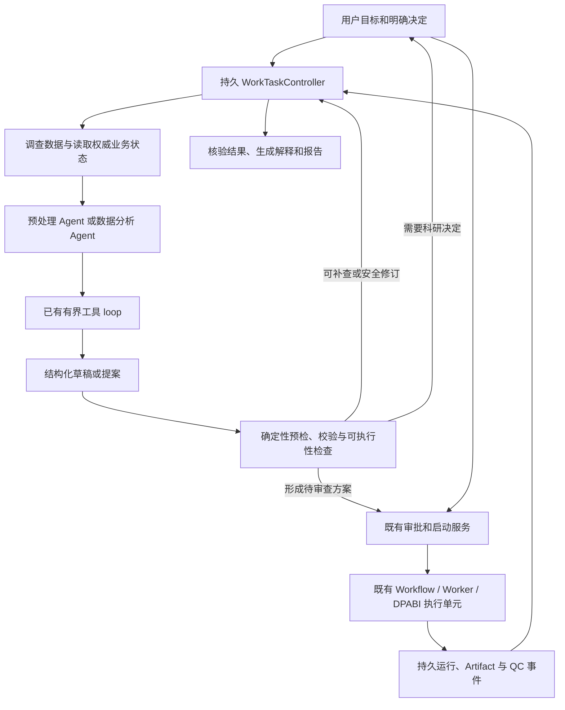

# 计划 0014：静息态 fMRI Agent 通用自动化体验

- 状态：Implementing
- 文档类型：Plan
- 维护者：system_architect
- 创建日期：2026-10-11
- 更新日期：2026-10-12
- 关联：[MVP 验证与已知限制](../development/mvp-verification.md)、[Skill 层架构](../architecture/fmri-skill-layer.md)、[Work 双 Agent ADR](../adr/0024-work-dual-agents.md)、[Agent 控制面 ADR](../adr/0015-agent-control-plane-hardening.md)、[DPABI 单次预处理 ADR](../adr/0021-single-pass-dpabi-preprocessing.md)、[ADR 0036](../adr/0036-persistent-work-task-boundary.md)、[ADR 0037](../adr/0037-fmri-input-identity-and-evidence.md)、[ADR 0038](../adr/0038-logical-plan-to-execution-units.md)

## 目标里程碑

在现有预处理 Agent、数据分析 Agent、Skill、审批和 MATLAB Worker 基础上，建立能跨消息和运行事件持续推进的任务流程；让系统先调查数据、检查可执行路径，再集中询问必要的科研决定；让可恢复的工程阻断进入有界恢复过程；把逻辑科研步骤与 DPABI 实际执行单元对应起来。

计划交付后，在已声明支持范围内，用户无需逐步指导 Agent 读取什么、切换哪个角色或计算结束后说“继续”。用户仍保留科研方案审查和当前规定的执行/QC 决策权。

本计划不增加第三个模型协调 Agent，不迁移现有模型框架，不允许模型执行任意 MATLAB/Shell，不以自动改变科学方法、排除样本或追求显著结果来提高完成率。

计划 0013 已完成的双 Agent、交接、统计、结果解释和报告功能是本计划的复用基线，不在本计划重复实现。能力扩展应纵向贯穿输入、设计、执行、证据与结果，并分别验收。

## 验收标准

1. 单个用户目标有独立、持久的推进状态；页面关闭、API 重启或重复/乱序运行事件不会丢失状态或重复创建计划、审批、作业。
2. Agent 的草稿经过应用服务的结构化预检。能从授权来源读取的事实由系统补查；存在明确、安全的草稿修订时可在共享预算内重新校验；无进展时停止并说明具体阻断。
3. 任务状态不复制或替代 PlanRevision、ApprovalRecord、WorkflowInstance、QC 和 Artifact 的事实来源；后台恢复不借用前台角色或旧的一次性授权。
4. 等待 MATLAB/Worker 时不持续调用模型。运行事件唤醒任务后，系统重新读取权威状态，再决定准备下游草稿、报告、等待用户或终止。
5. 预处理逻辑 DAG 清楚标出合并的一次 DPARSFA 调用、调用前后检查、可复用的已核验 checkpoint，以及实际不可暂停的执行边界。
6. 数据目录或元数据缺失时，系统可以自动检查安全范围内的证据，并把无法判断的事项按来源呈现。未知事实不会默认为已验证。
7. 单组、配对、表驱动分组、多 run/session、metric-only 和批量 checkpoint 的支持范围在生成计划前可判定；未实现组合会在提交计算前返回能力边界。
8. QC、输入变化、mask/空间不匹配、统计设计秩亏、超时/重试、零显著结果等均符合本计划的场景验收矩阵。
9. 真实统计方法、纳入名单、排除决定、阈值、尾部和协变量不会因自动恢复被静默更改。零显著结果按成功分析收口。
10. 新能力有确定性领域与故障验证、Mock 应用交互验证，并按用户单独授权完成相应真实 Provider 或合成 MATLAB 验收。三类证据分别报告，不以 Mock 代替真实科学执行或模型质量评估。

## 当前基线与问题

当前已有有界模型工具循环、READ/PROPOSE/EXECUTE 权限隔离、预处理和分析角色独立草稿、计划审批、SQLite 幂等与 Worker 重试/租约恢复。受控 MATLAB 模板、DPABI 适配器、输入哈希和实际产物检查也已具备，作为可信执行基础保留。

需要补足的边界：

- Agent loop 在一次模型请求内迭代读取；Work 现在只对预处理/分析草稿提案动作提供有限的同轮预检修订。Skill 编译、统计设计装配和执行前的所有校验仍未统一成通用“反馈—补查—重验”应用服务，分析中的科研缺项继续等待用户决定。
- `ConversationWorkTaskView` 保存角色与草稿/计划/运行引用，但没有完整用户目标、等待条件、恢复记录、完成条件与任务累计预算。
- 双向 handoff 记录和角色路由已实现；分析缺少上游指标时仍可能让用户手动切换角色继续。尚缺消费任务依赖、等待 Worker/QC、自动续接分析的确定性调度。
- `SkillResolver` 以有限指标组合选择 Skill。数据扫描能够看到的实体、session/run 和已有中间阶段与执行器实际支持范围仍有差距。例如主预处理单 session，metric-only checkpoint 目前限单主体。
- 外部指标目录仍以显式组/条件导入为主；单组目录现可登记为一个纳入组并进入单样本候选，但多 session/run、人口学表驱动纳入和复杂重复测量结构仍未覆盖。
- Skill 的逻辑步骤不能自动推导出 DPABI 的物理暂停点。当前主模板为一次 `DPARSFA_run` 调用，并在执行后检查实际产物；已有受控 checkpoint 输入复用不等于任意失败节点都能断点续跑。
- 一些限制属于当前已审核 Skill 或实现能力边界，不能统称为 fMRI 科学硬规则。预检必须显示错误类别与补救候选。

主要代码入口：`neuroagent/agent/loop.py`、`neuroagent/application/service_mixins/conversations.py`、`neuroagent/application/work_dialogue.py`、`neuroagent/application/work_tasks.py`、`neuroagent/application/work_handoffs.py`、`neuroagent/skills/resolver.py`、`neuroagent/skills/models.py`、`neuroagent/domain/fmri/artifacts.py`、`neuroagent/execution/preprocessing.py`、`matlab/templates/run_preprocessing.m.tmpl` 和 `neuroagent/infrastructure/matlab_executor.py`。验收事实以验证文档最新记录为准。

## 目标流程

任务控制器是应用层确定性服务，不运行第三个模型。它推进用户目标；WorkflowInstance 仍是科研作业状态唯一真源。Worker 继续负责作业领取、attempt、租约、有限重试和终态。模型仍只能 READ/PROPOSE；真实执行、QC 和审批继续经过现有服务与授权入口。

## 实施阶段

### 阶段 A：结构化预检与有限的校验反馈

当前状态：结构化反馈合同、预检上下文及 Work 两角色的同轮回路已接入。预处理只允许在模型提出的未批准草稿范围内作有界修订，并共享本轮剩余模型预算；分析草稿缺少检验、基线、预测量或推断参数时会保留为用户决定，不替用户补选。最终持久化反馈沿用相同的冲突/科研决定分类。此切片尚未把所有 Skill 编译器与统计设计装配校验统一为一项完整 dry-run 服务，因此阶段 A 仍未全部达标。

目标是先减少一轮对话内不必要的人工技术排错，不启动跨消息后台循环。

任务：

- 定义统一 `PlanningIssue`：问题类别、影响对象、缺失证据、来源、允许的修复候选、是否改变科学语义、所需用户决定和是否可重试。
- 把 Skill 编译和统计草稿检查以 dry-run/预检形式暴露给相应角色。预检不得创建批准、Run、MATLAB 进程或改变用户选择。
- 模型可选择的修复仅来自已注册的 READ 工具和未批准草稿修改，不接受自由命令、自由 MATLAB 文本或任意文件写入。
- 有可读元数据时自动读取并重新校验；需要研究者判断时合并问题；同样证据、同一失败反复出现时停止。
- 保持当前一次请求的步数、token 和墙钟总预算在工具调用、修订与结构回退间共享。
- 记录一项预处理缺采集元数据场景和一项统计草稿校验阻断场景。

主要落点：`application/work_dialogue.py`、`application/work_draft.py`、`application/statistics_draft.py`、`skills/models.py`、相应预检服务及角色只读工具。

完成条件：可读取事实不会再作为人工抄录问题；不可修复或涉及科研决策的问题有精确说明；旧确认不能应用到新草稿；达到预算/无进展时能收口。

### 阶段 B：持久任务推进与事件唤醒

当前状态：已完成 WorkTask/TaskStep 模型、SQLite schema/repository 和应用服务组合接线；事件消费有任务 Run 引用核对、去重回执、单调游标及乐观版本控制。`reconcile_waiting_run(task_id)` 已接入 Event、Run、QC 与 Artifact 现有应用端口：事件只提供去重身份和唤醒信号，之后重读权威状态。读取 Run/QC/Artifact 期间以 Run `version` 前后夹读；最多重试三次，持续变化时返回 `indeterminate` 并保留任务生命周期状态。运行中或 Worker 可重试状态保持等待同一 Run；`QC_REVIEW` 中 `pending`/`awaiting_review` 且审查记录尚无或为 `draft` 时，以及 `failed` 且最新审查为 `draft` 时转为 `waiting_user`；`failed` 缺少审查或审查状态与 Run 不一致时阻断。终态失败、引用 Artifact 不存在或不属于当前项目时转为 `blocked`。任务引用的 Artifact ID 按通用引用处理，允许指向上游 Run；当前 Run 的登记产物清单单独返回，不与通用引用做差集。成功且 QC 已批准/显式跳过后转为 `waiting_dependency`，等待目标级产物完整性与下一步骤检查。该切片不读事件 payload、不调用模型、不写 Plan/Approval/Run、不创建 Run，也不自动审批 QC。后台事件订阅、领取/唤醒调度和目标级下游准备仍未实现，因此本阶段尚未达到自动续接验收。

阶段 B 纵向接线（2026-10-12）：预处理 Work 的对话 finalize、`work-draft` 和 `work-review` 在真实 preprocessing `SkillPlan` 成功提交后，按 `(conversation_id, preprocessing, plan_revision_id)` 的确定性 ID 创建或复用一个 `waiting_user` WorkTask，并在同一 Unit of Work 中保存会话角色链接。目标说明来自能由预处理角色/草稿/方案证明关联的用户消息；缺少原始请求时使用带 Plan ID 的执行目标。任务权威引用保留会话、Plan 和冻结 `manifest_hash`；完成条件明确涵盖 Run 成功、实际 QC 决定和该 Plan 的 artifact expectations。显式一次性确认在现有 `send_conversation_turn` finalize 中提交 Run、确认消费、同一任务转入 `waiting_run` 及会话 Run 链接；绑定冲突会回滚该事务。部分对话入口的 Plan 已在 finalize 前的 prepare 中保存，因此这里只承诺任务与会话链接，以及明确授权启动 Run 的原子收口，不概括承诺所有入口的 Plan 创建均与任务同事务。HTTP ConversationWorkTask 响应补充 `work_task_id`。定向集成测试验证 draft 编译/review 复用、无效确认、finalize 故障回滚后同确认重试、Run 幂等重放和错项目拒绝；测试只创建排队记录，不运行 MATLAB。此接线只覆盖预处理 Plan；统计任务、事件订阅/后台调度、依赖继续及目标 artifact 成功判定仍未实现。

目标是解决关闭页面、等待运行、跨角色交接后需要用户手动“继续”的问题。

任务：

- 在 `application/automation/` 建立应用服务，创建 `WorkTask`、`TaskStep` 及 SQLite 持久化契约。任务只保存目标进度、权威状态引用、等待条件、预算、恢复步骤和版本。
- 用去重键和消费游标接入持久 Worker/Workflow 事件。收到事件后重新查询 Run、QC、输入修订和产物，不能把旧事件 payload 当作当前事实。
- 在同一 SQLite 上采用有限并发、短领取租约和幂等提交；不引入消息中间件或微服务。
- 将当前请求处理逐步拆成 `prepare_step`、`validate_step`、`finalize_step`，让用户消息入口和系统事件入口共用业务步骤。系统恢复记录使用独立事件类型，不伪造用户消息。
- 等待真实作业时释放模型调用；完成后按目标条件自动准备下一项草稿、QC 摘要或确定性报告。
- 区分 `waiting_user`、`waiting_run`、`waiting_dependency`、`completed`、`blocked`、`cancelled` 等目标任务状态；Run 本身状态仍从现有 Workflow 查询。
- 版本冲突时丢弃旧提案并重新读取；任务共享预算不因切角色、重启、重试或 fallback 重置。

主要落点：`application/automation/`、应用端口、SQLite models/migrations/repository、`bootstrap.py` 与现有 Worker 事件查询。API/SSE 增量只在 UI 需要展示任务状态时添加。

完成条件：应用重启和页面关闭后同一任务可恢复；重复或乱序事件不重复创建运行；运行重试不会被第二个运行取代；没有科研决定等待时可继续自动推进；确认依然绑定角色、方案和输入修订。

### 阶段 C：统一数据事实和更宽容的输入适配

当前状态：完成单组外部指标目录登记并进入单样本候选设计的最小纵向切片；配对设计仍强制要求两个明确条件。统一 session/run 身份、表驱动分组与批量 checkpoint 尚未实现。

目标是让用户不必把数据重排成单一目录形状，也不必逐个样本指挥任务。

任务：

- 在现有 manifest 与 `ArtifactLineage` 上表示 subject/session/run/modality/condition/metric 身份，并保留值的来源及核验级别：executor verified、用户声明、候选推断、unknown。
- 统一描述一组统计输入：受试者/条件、指标和 scale、图像引用、mask、空间、谱系引用；排序和连接始终显式绑定 subject_id 与 condition。
- 支持目录调查生成“输入映射提案”；适配单组、平铺和人口学表驱动分组，不从文件夹数量猜科学分组，不修改原始数据。
- 将外部目录文件名识别降为候选，支持研究者确认表列、指标身份及空间来源；未知预处理史继续作为未知。
- 评估批量 verified checkpoint：每人单独登记成功/失败证据，同时对依赖全组样本集合的操作绑定集合 hash；不得把 group-level DARTEL 等作业无条件按主体切块。
- 多 session/run 出现时先显式识别重复测量结构，不把 scan 当独立受试者；超出能力时提前阻断。

主要落点：`infrastructure/filesystem/dataset_inspector.py`、`analysis/external_metric_import.py`、`domain/fmri/external_import.py`、manifest/Artifact 输入合同、统计设计装配和外部导入页面。

完成条件：单组影像可进入单样本/相关候选流程；按 subject_id 的表驱动纳入可审查；乱序与多 session 不发生错配；未知事实不能通过伪造标签变为 verified。

### 阶段 D：能力目录、数据状态规划与物理执行单元

当前状态：预处理编译结果现在附带一次 `DPARSFA_run` 的描述性 `ExecutionUnit` 映射，标明输入/输出、调用前后 gate 和重试边界；当前 Worker 仍以既有 JobSpec/产物合同执行，并未消费该对象，也没有调用内暂停或分段恢复能力。故此映射改善了可审查性，不代表已实现断点续跑。

目标是在已审核科学范围内，按输入的真实状态寻找不同合法路径，而不是继续增加 WorkDialogue 特例。

任务：

- 增补 Skill/capability 的状态前置条件、状态变化、作用域、参数/证据要求、适用范围、冲突、executor strategy 和验证成熟度。
- 从有限、已审核的协议和候选路径开始；模型负责解释目标和候选，确定性解析器检查依赖与输入绑定。不在首期实现无约束任意 DAG 搜索。
- 将逻辑 DAG 编译成一个或多个真实 `ExecutionUnit`。每个单元声明 DPABI 调用、输入/输出、调用前后 gate、资源、重试范围和实际可物化的 checkpoint。
- 对同一逻辑 capability 的复用验证输入内容、参数、软件与模板版本、mask/网格、空间和样本集依赖；复用仅基于已核验产物。
- 明确文档与模板的一次 `DPARSFA_run` 语义；若改为真正分段执行，需实现真实落盘检查点、伴随证据和单独的 DPABI/Worker 验收。
- 在预检阶段识别单会话、批量 metric-only、不同阶段 mask、OnResults normalization 等确切支持边界。

主要落点：`skills/models.py`、`skills/resolver.py`、`skills/compiler.py`、`skills/validation.py`、`execution/preprocessing.py`、MATLAB 固定模板及 Workflow JobSpec。

完成条件：原始、合格中间时序、已有指标三种输入状态产生不同且可解释的候选路径；逻辑节点不会被误报成物理 checkpoint；计划提交前能发现已知不支持组合。

### 阶段 E：扩展指标和分析设计

在 A–D 稳定后逐项纵向扩展 FC、多 session/run、更多统计设计。FC 至少拆分 seed-to-voxel 图和 ROI-to-ROI 矩阵的来源、空间、seed/atlas、尺度、设计和多重推断合同；不能只给 `MetricKind` 增加枚举。多指标/多 seed 的推断范围另行定义，不能把独立显著性校正任务简单相加成一个全研究的校正保证。

每个新能力贯穿目录调查、schema、方法审核、解析校验、DPABI 映射、实际产物、报告与故障场景。无法确认实现的能力保持 gated，不生成可执行伪方案。

## 关键科研与授权边界

- TR、频段、GSR、回归项、scrubbing、平滑、空间和统计方法均区分数据证据、项目协议与用户选择。来源缺失或冲突时不猜默认值。
- ALFF/fALFF/ReHo 的当前 Skill 顺序规则继续保留；“当前 Skill 未批准的路径”不得扩写成该指标一概不允许的普遍科学规律。
- fALFF 的滤波与回归设置需作为同一完整方法合同检查。文献报告了频谱不匹配导致噪声重入的风险；没有一种方法适用于所有课题。
- 图像网格相同不能证明空间相同；掩膜和图谱定位必须基于核验空间与真实 lineage。
- 预处理成功和 QC 通过不是同一决定；自动 QC 证据不能自动变成受试者排除。
- 统计失败后不得自动改变对比、尾部、校正阈值、协变量或纳入人数。零显著结果照常生成报告。
- 新授权不得隐含在“继续任务”中。若以后希望一次授权多个实际运行、自动排除或恢复范围，先立专项 ADR，绑定输入/方案 hash、项目、权限范围和停止条件。
- 已有 Worker 重试由 Worker 负责；任务控制器只等待并消费其事件。任务控制器不生成新 Run 来重试已有 attempt。

方法学参考：

- Yan et al. 2016, DPABI: Data Processing & Analysis for (Resting-State) Brain Imaging. [PubMed](https://pubmed.ncbi.nlm.nih.gov/27075850/)
- Hallquist et al. 2013, The nuisance of nuisance regression. [PubMed](https://pubmed.ncbi.nlm.nih.gov/23747457/)
- Ciric et al. 2017, Benchmarking participant-level confound regression. [PubMed](https://pubmed.ncbi.nlm.nih.gov/28302591/)
- fMRIPrep 官方[流程说明](https://fmriprep.org/en/stable/workflows.html)与[输出说明](https://fmriprep.org/en/stable/outputs.html)，作为按元数据分支、区分预处理与去噪及报告结构的设计参考，不作为 DPABI 科学默认值。

## 体验验收矩阵

| 场景 | 验收结果 |
| --- | --- |
| 用户只说“计算 ALFF 和 ReHo”，输入分别为原始序列、已核验中间时序或只有最终指标 | 自动检查输入、提出适用路径；已有任务不重复处理；缺必要时序时明确说明 |
| 方案缺 TR，文件证据中存在可靠 TR | 自动读取、绑定来源并重新校验，无需用户代查 |
| 输入 header 与 sidecar 对 TR 或空间意见冲突 | 展示证据冲突并集中询问，不静默择一 |
| ReHo 首选文件已平滑，目录中存在合格未平滑来源 | 找到并核验替代输入，生成新草稿修订；不声称可逆平滑 |
| 多个 subject 各有已核验 checkpoint | 支持范围内一次提出批量任务，并分别记录成功与失败 |
| 单组外部 ALFF 做单样本/相关 | 不要求伪造第二个组目录；组/协变量仍显式绑定 |
| BIDS/普通目录有多 session、多 run | 识别实体和配对关系，不能当独立受试者重复计数 |
| 统计矩阵秩亏 | 精确指出冲突字段并给出草稿候选，不静默删除协变量 |
| Worker 自动 retry，或收到重复完成事件 | 等待同一运行；重复消费不会创建第二个 Run 或再次批准 |
| API/应用重启，或客户端中途断开 | 恢复已持久的任务进展与结果，不伪造用户消息 |
| 同一个错误和同一版本输入重复发生 | 无进展退出，返回原因与需用户行动，不无限调用模型 |
| 用户编辑草稿与后台预检并发 | 版本比较阻止旧草稿覆盖新选择，重新加载后续推进 |
| 运行完成且 0 个显著体素 | 作为正常统计结果完成解释与复现报告，不触发方法/阈值变更 |
| 用户请求 FC 或其他尚未注册能力 | 在执行前说明精确能力缺口，不生成任意可执行代码 |

## 验证、风险与完成报告

### 本轮实现记录（2026-10-12）

本轮形成了四个可独立审查的垂直切片：

- **持久目标状态**：增加 WorkTask/TaskStep 状态合同、SQLite 迁移与仓储、版本化应用服务，并在应用组合根与现有数据库/Unit of Work 共享事务。任务只保存权威对象引用。`reconcile_waiting_run(task_id)` 从事件仓储读取绑定 Run 的新事件，在验证整个事件批次身份后逐个原子记录去重回执/游标，再从现有 Run、QC、Artifact 端口重读权威记录并返回结构化 readiness；Run `version` 在三次尝试中仍不稳定时返回 `indeterminate`，不改变任务生命周期状态。Artifact 引用按 ID 解析并校验项目归属，可来自上游 Run；本切片不以当前 Run 的产物清单推断通用引用缺失，也未实现任务目标级完整性合同。重复消费不重复推进；成功运行仍只进入 `waiting_dependency`，后续步骤解析器、后台事件订阅、任务领取租约与恢复调度仍缺。
- **预检反馈**：将现有参数/统计校验消息映射为带证据来源、科学语义影响、允许修复边界和指纹的结构化问题。Work 两角色提案路径的有限回路已通过专门集成测试；预处理共享剩余预算修订未批准草稿，分析科研缺项保持为用户决定。该切片没有接管编译、设计装配或授权入口。
- **单组导入**：一个外部指标组可纳入并形成单样本分析候选；配对设计仍需恰好两个条件组，不凭目录数推断条件。该切片不覆盖完整统计方法、单样本数据学假设审查或广义多 session 设计。
- **执行单元映射**：预处理编译产物标注单次 `DPARSFA_run` 的物理边界。该合同目前仍未驱动 executor，也没有建立真实物化 checkpoint；既有一次性 DPABI 调用、Worker retry 和产物检查保持原语义。

本轮定向验证：反馈/Work 集成、单组外部导入、WorkTask 持久化服务、执行单元映射及相关回归共 87 项通过；另单独执行科学测试集为 345 项通过、6 项跳过。文档规范检查、相关文件 Ruff 与 Mypy 通过。现有全量后端和前端测试尚未通过：后端出现旧 composition-root mock 接口等兼容失败；前端失败集中在 Node 测试使用相对 `/api/...` URL 的 fetch 解析等既有问题。定向通过不替代全量门禁。未执行真实 MATLAB 计算，不能据此声称 DPABI 数值路径通过。

阶段 B 后续小切片（2026-10-12）：新增按 `task_id` 重核等待中 Run 的应用用例，并在组合根注入现有事件/运行/QC/Artifact 只读端口。SQLite 应用集成测试覆盖运行中、同一 Run 的 retryable 失败与终态失败、成功+QC pending/approved、QC 审查期间版本变化后重读、连续版本变化返回 `indeterminate`、`QC_REVIEW` + failed + draft 等待用户、`awaiting_review` 且尚无草稿时等待用户创建审查、失败状态缺失/冲突审查证据时阻断、上游 Run Artifact 引用、错 Run 事件拒绝及重复事件无二次推进；当前三个 automation 后端测试模块 26 项通过。测试通过不代表已有后台订阅器或续接调度器。当前 task readiness 对成功且 QC 已审定的处理是明确等待目标级依赖，而不是宣称整个 WorkTask 完成。

各阶段分别提交可运行垂直切片，不绑定微服务迁移、目录大搬家或统计科学语义变化。风险最高的是任务提交/幂等/事件收口、后台角色与前台确认边界、输入版本变化、执行单元承诺与 DPABI 实际调用不一致，以及将研究者选择误处理为自动修复。

每个实施阶段记录：确定性合同和故障验证、Mock 应用交互、真实 Provider 规划质量范围、MATLAB 合成数据方法/数值证据，以及尚未覆盖的输入条件。未获单独授权不启动真实长作业，不处理或写入原始研究数据。

体验指标建立前后对照：用户需要的技术纠错轮数、重复询问已核验事实次数、支持范围内自动完成比例、可恢复问题恢复率、重复阻断率、重复计算量、重启恢复率和模型调用预算。将“需要科研决定”“能力不支持”“安全拒绝”单独报告，不能通过排除困难任务抬高完成率。

任何公共接口、SQLite 状态来源、确认范围、数据合同或 DPABI 执行边界改变，实施时更新相关 ADR/文档/API/迁移与 [MVP 验证记录](../development/mvp-verification.md)。尤其“持久任务与 WorkflowInstance 状态边界”“逻辑 DAG 至物理执行单元”“批量/多会话身份合同”需在改代码前分别形成 ADR；已接受 ADR 作为历史保留，以新 ADR 补充或替代。
